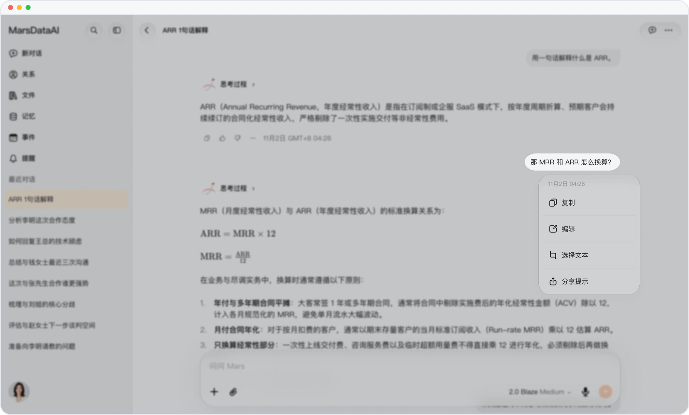
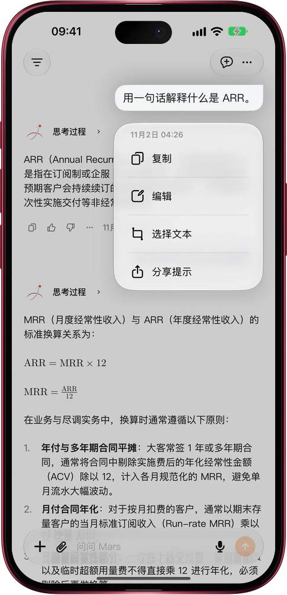

# 问题没问对？改一句，重新回答

> **预览** · 2026-11-08 · `0.1.1.11207`
> 以下功能目前处于预览阶段，尚未正式上线。

话刚发出去，才想到真正想问的是什么？

长按或右键你发出的提问，菜单里多了「编辑」：原话直接回到输入框，改几个字就能再发。改的是最新一条提问，Mars 就在原处按新问题重新回答；改的是更早的提问，Mars 另开一个分支对话，只带上这条提问之前的内容，再回答你改过的问题，原来的对话一字不动。提问附带的文件也会一起带上。网页版和 iPhone、iPad、Mac 上的 iOS 应用都已支持。不用复制粘贴，不用整段重打，也不怕改乱想保留的对话。

想到更好的问法就改，直接拿到你真正想要的回答。

*示意图，使用虚构演示数据。*

*示意图，使用虚构演示数据。*

[体验预览版](https://marsdata.ai/changelog/edit-your-question) · [全部更新](../README.zh-CN.md)

[English](./crm-2026-11-08-edit-your-question.md) · [繁體中文](./crm-2026-11-08-edit-your-question.zh-HK.md)
