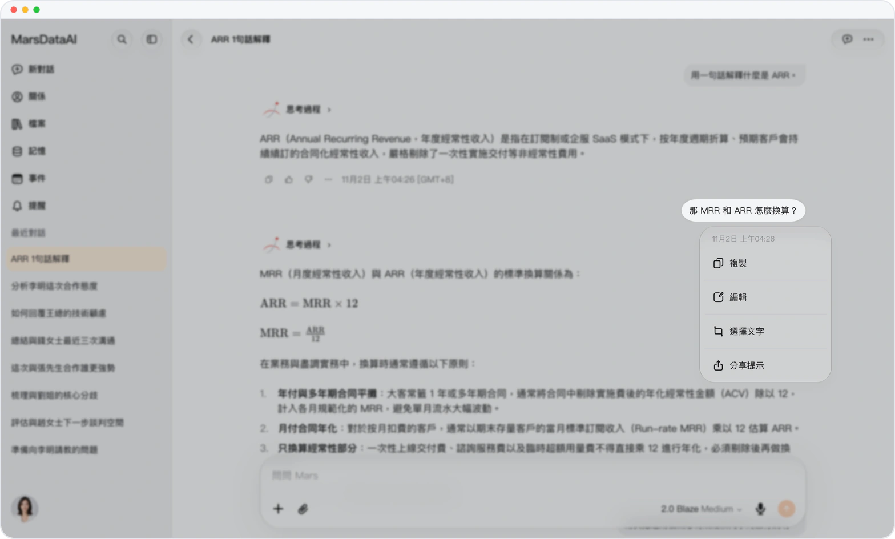
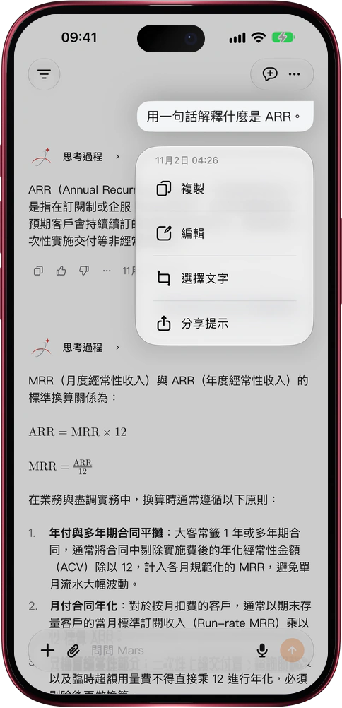

# 問題沒問對？改一句，重新回答

> **預覽** · 2026-11-08 · `0.1.1.11207`
> 以下功能目前處於預覽階段，尚未正式上線。

話剛發出去，才想到真正想問的是什麼？

長按或右鍵你發出的提問，菜單裏多了「編輯」：原話直接回到輸入框，改幾個字就能再發。改的是最新一條提問，Mars 就在原處按新問題重新回答；改的是更早的提問，Mars 另開一個分支對話，只帶上這條提問之前的內容，再回答你改過的問題，原來的對話一字不動。提問附帶的文件也會一起帶上。網頁版和 iPhone、iPad、Mac 上的 iOS 應用都已支持。不用複製粘貼，不用整段重打，也不怕改亂想保留的對話。

想到更好的問法就改，直接拿到你真正想要的回答。

*示意圖，使用虛構演示資料。*

*示意圖，使用虛構演示資料。*

[體驗預覽版](https://marsdata.ai/changelog/edit-your-question) · [全部更新](../README.zh-HK.md)

[English](./crm-2026-11-08-edit-your-question.md) · [简体中文](./crm-2026-11-08-edit-your-question.zh-CN.md)
