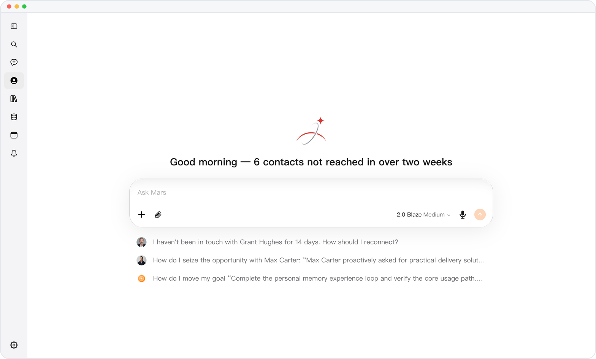
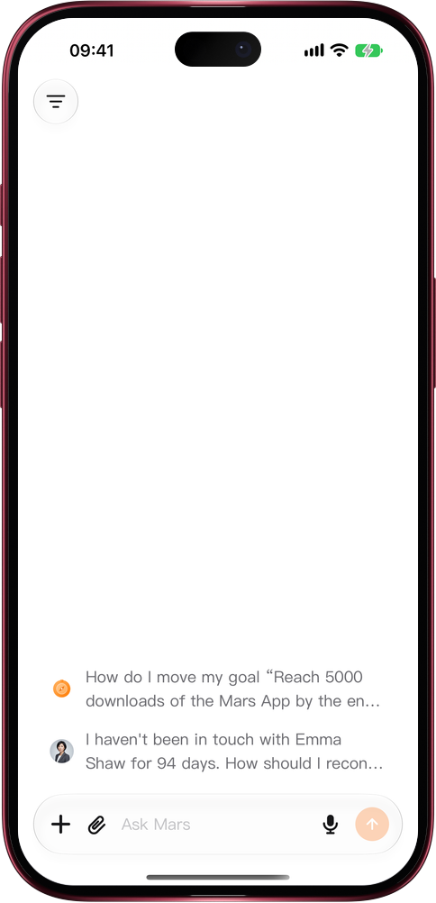

# Mars on the web: 60% less to download

> **Preview** · 2026-11-10 · `0.1.1.11493`
> These features are available in the preview version and have not been generally released.

Every second spent watching a page load is a second not spent on your work.

Opening Mars on the web now downloads about 330 KB before the first screen appears, down from 825 KB: roughly 60% less. Mars loads only the language you read it in, instead of all six at once. On a device where you have used Mars before, your relationships, conversations and account start loading together with the app, not after it has finished. Your file list now loads when you open the file picker, instead of on every page. The screens and how you use them stay the same.

Less waiting on a slow connection, and Mars is ready the moment you need it.

*Illustration using fictional demo data.*

*Illustration using fictional demo data.*

[Explore the preview](https://marsdata.ai/changelog/lighter-web-opening) · [All updates](../README.md)

[简体中文](./crm-2026-11-10-lighter-web-opening.zh-CN.md) · [繁體中文](./crm-2026-11-10-lighter-web-opening.zh-HK.md)
