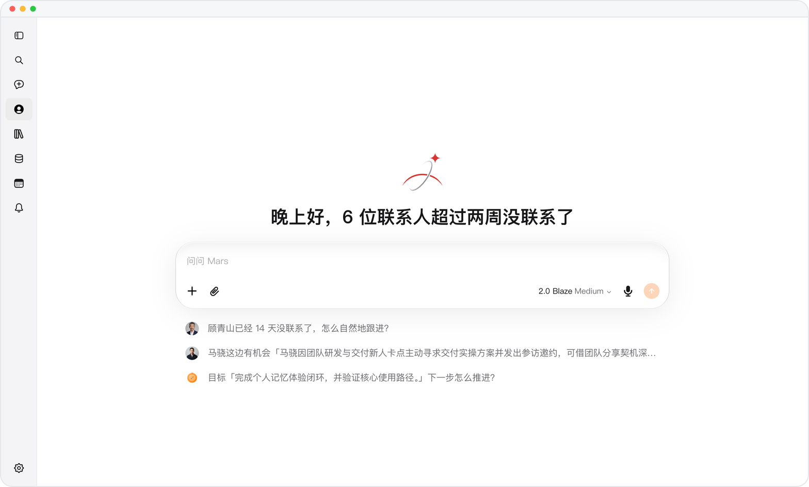
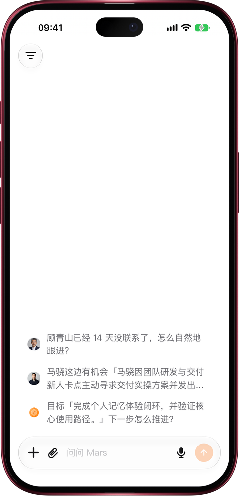

# 网页版打开，下载少一半多

> **预览** · 2026-11-10 · `0.1.1.11493`
> 以下功能目前处于预览阶段，尚未正式上线。

打开网页干等加载，最耽误事。

在网页上打开 Mars，首屏出现前需要下载的内容从 825 KB 降到约 330 至 380 KB（随语言不同），少了一半以上。Mars 只加载你正在使用的那一种语言，不再六种语言一起下载。在用过 Mars 的设备上，关系、对话和账号信息与应用同时开始加载，不必等应用加载完再读。文件列表改为打开文件选择时才读取，不再每个页面都读一遍。界面和用法都不变。

网络再慢也少等一会儿，想用 Mars 时它已经准备好了。

*示意图，使用虚构演示数据。*

*示意图，使用虚构演示数据。*

[体验预览版](https://marsdata.ai/changelog/lighter-web-opening) · [全部更新](../README.zh-CN.md)

[English](./crm-2026-11-10-lighter-web-opening.md) · [繁體中文](./crm-2026-11-10-lighter-web-opening.zh-HK.md)
