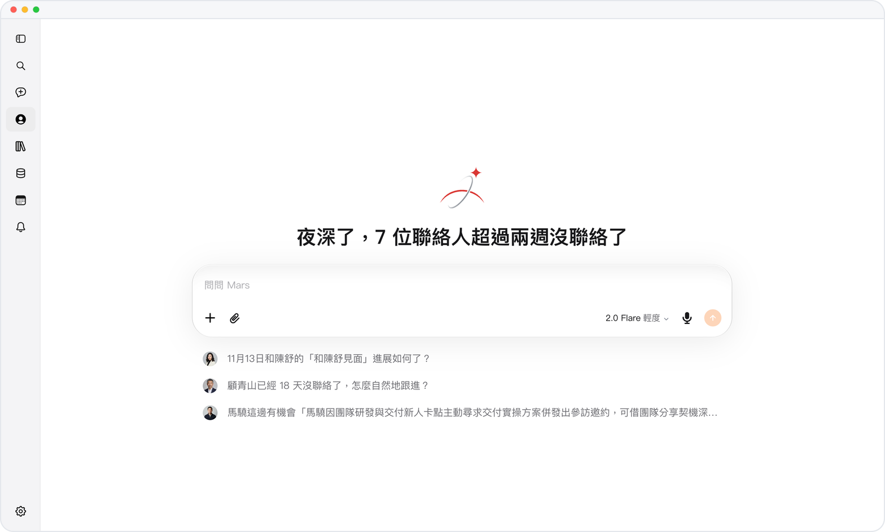
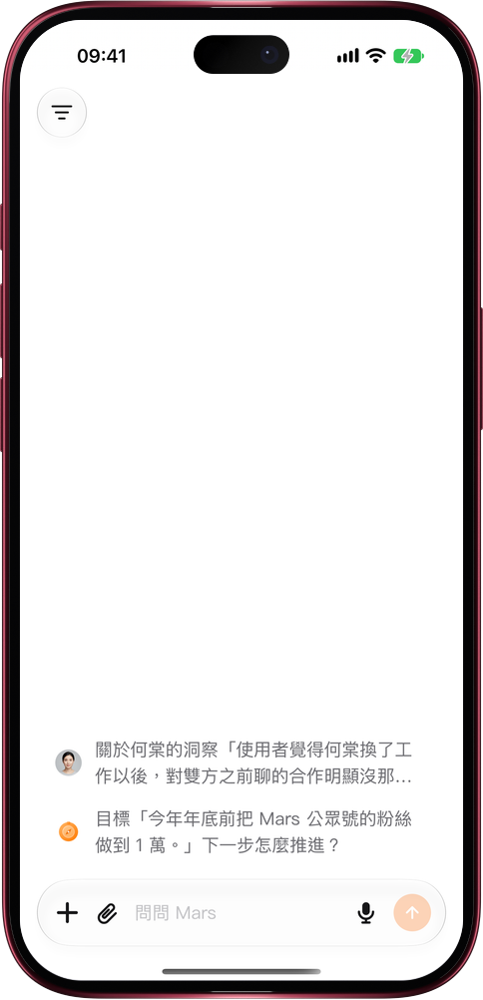

# 網頁版打開，下載少一半多

> **預覽** · 2026-11-10 · `0.1.1.11493`
> 以下功能目前處於預覽階段，尚未正式上線。

打開網頁乾等加載，最耽誤事。

在網頁上打開 Mars，首屏出現前需要下載的內容從 825 KB 降到約 330 至 380 KB（隨語言不同），少了一半以上。Mars 只加載你正在使用的那一種語言，不再六種語言一起下載。在用過 Mars 的設備上，關係、對話和賬號信息與應用同時開始加載，不必等應用加載完再讀。文件列表改為打開文件選擇時才讀取，不再每個頁面都讀一遍。界面和用法都不變。

網絡再慢也少等一會兒，想用 Mars 時它已經準備好了。

*示意圖，使用虛構演示資料。*

*示意圖，使用虛構演示資料。*

[體驗預覽版](https://marsdata.ai/changelog/lighter-web-opening) · [全部更新](../README.zh-HK.md)

[English](./crm-2026-11-10-lighter-web-opening.md) · [简体中文](./crm-2026-11-10-lighter-web-opening.zh-CN.md)
