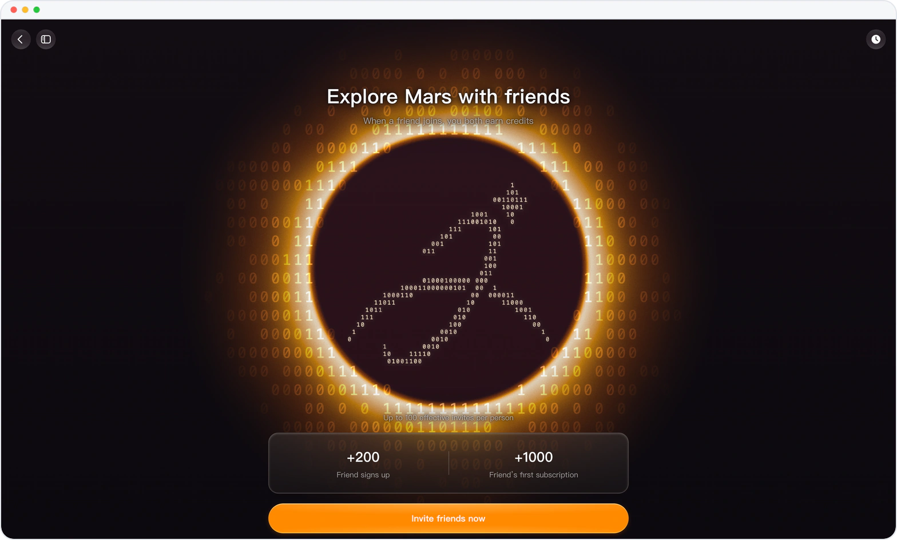
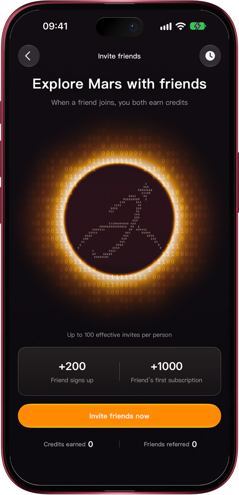

# Bring a friend, you both get credits

> **Preview** · 2026-11-11 · `0.1.1.11804`
> These features are available in the preview version and have not been generally released.

Mars is better with the people you'd trust to see it first.

Open Invite rewards in Settings, or tap the invite banner on the new-chat home, and send your own invite link. On the web, copy the link or download a ready-made invite card; in the iOS app, Invite friends now opens the share sheet with the card, its QR code and the link. When a friend signs up through it, you each get 200 credits; when they first subscribe, you each get 1,000 more, for up to 100 friends. Invite history shows each friend's status and the credits you earned. Unspent reward credits carry over when your plan renews. No codes to type, nothing to track by hand: every reward lands in both accounts on its own.

Share Mars with the people who matter, and keep going on the credits you both earn.

*Illustration using fictional demo data.*

*Illustration using fictional demo data.*

[Explore the preview](https://marsdata.ai/changelog/invite-friends-earn-credits) · [All updates](../README.md)

[简体中文](./crm-2026-11-11-invite-friends-earn-credits.zh-CN.md) · [繁體中文](./crm-2026-11-11-invite-friends-earn-credits.zh-HK.md)
