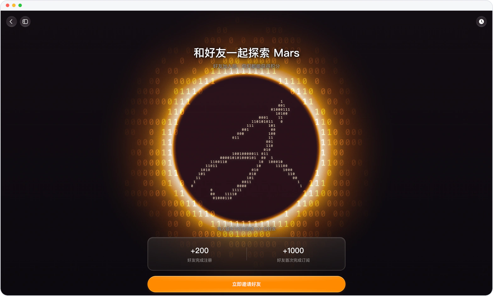
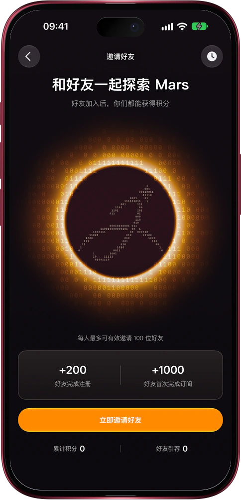

# 拉上好友一起用，双方都拿积分

> **预览** · 2026-11-11 · `0.1.1.11804`
> 以下功能目前处于预览阶段，尚未正式上线。

好用的东西，总想拉上身边人一起用。

在设置里打开「邀请有礼」，或点新对话首页的邀请横幅，就能发出你的专属邀请链接。网页版一键复制链接，或下载做好的邀请卡；iOS 应用点「立即邀请好友」，邀请卡、二维码和链接一起进分享面板。好友通过链接注册，你们各得 200 积分；好友首次订阅，再各得 1000 积分，每人最多可有效邀请 100 位好友。「邀请历史」里，每位好友的状态和你拿到的积分一目了然。没用完的奖励积分，套餐续费也不清零。

把 Mars 分享给在乎的人，赚到的积分让你们都能多用一阵。

*示意图，使用虚构演示数据。*

*示意图，使用虚构演示数据。*

[体验预览版](https://marsdata.ai/changelog/invite-friends-earn-credits) · [全部更新](../README.zh-CN.md)

[English](./crm-2026-11-11-invite-friends-earn-credits.md) · [繁體中文](./crm-2026-11-11-invite-friends-earn-credits.zh-HK.md)
