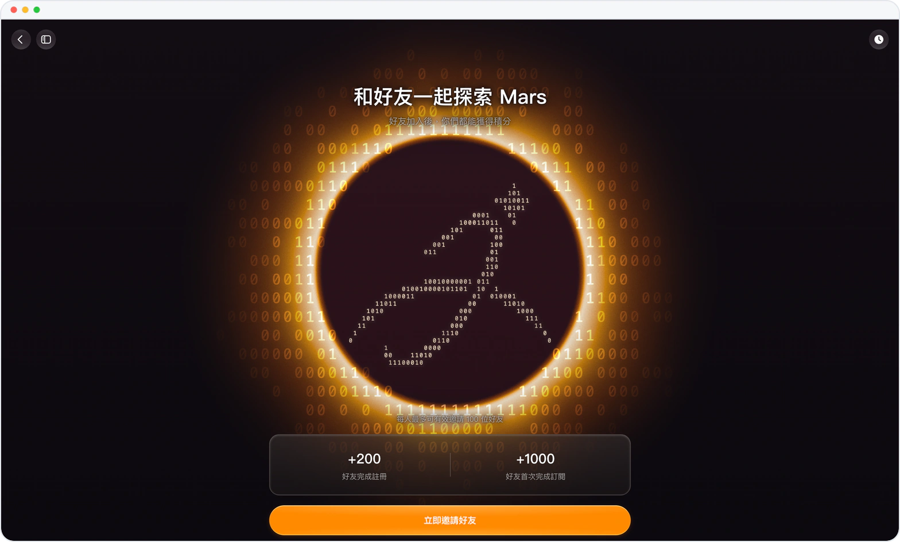
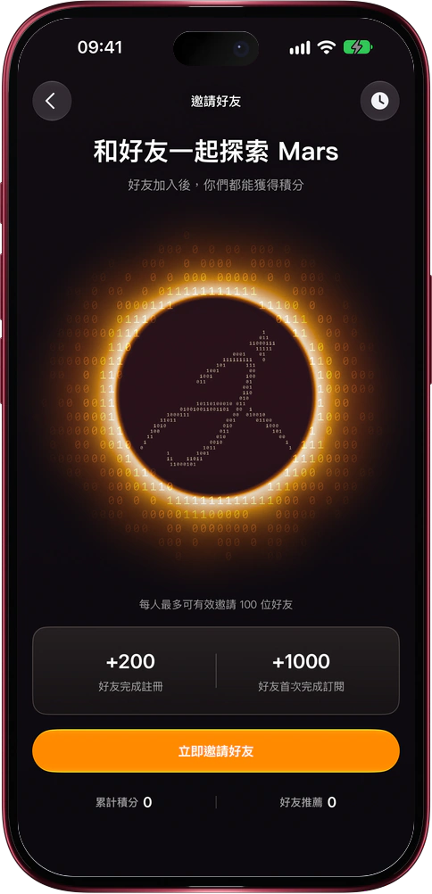

# 拉上好友一起用，雙方都拿積分

> **預覽** · 2026-11-11 · `0.1.1.11804`
> 以下功能目前處於預覽階段，尚未正式上線。

好用的東西，總想拉上身邊人一起用。

在設置裏打開「邀請有禮」，或點新對話首頁的邀請橫幅，就能發出你的專屬邀請鏈接。網頁版一鍵複製鏈接，或下載做好的邀請卡；iOS 應用點「立即邀請好友」，邀請卡、二維碼和鏈接一起進分享面板。好友通過鏈接註冊，你們各得 200 積分；好友首次訂閲，再各得 1000 積分，每人最多可有效邀請 100 位好友。「邀請歷史」裏，每位好友的狀態和你拿到的積分一目瞭然。沒用完的獎勵積分，套餐續費也不清零。不用手抄邀請碼，也不用自己記賬：獎勵自動到雙方賬户。

把 Mars 分享給在乎的人，賺到的積分讓你們都能多用一陣。

*示意圖，使用虛構演示資料。*

*示意圖，使用虛構演示資料。*

[體驗預覽版](https://marsdata.ai/changelog/invite-friends-earn-credits) · [全部更新](../README.zh-HK.md)

[English](./crm-2026-11-11-invite-friends-earn-credits.md) · [简体中文](./crm-2026-11-11-invite-friends-earn-credits.zh-CN.md)
