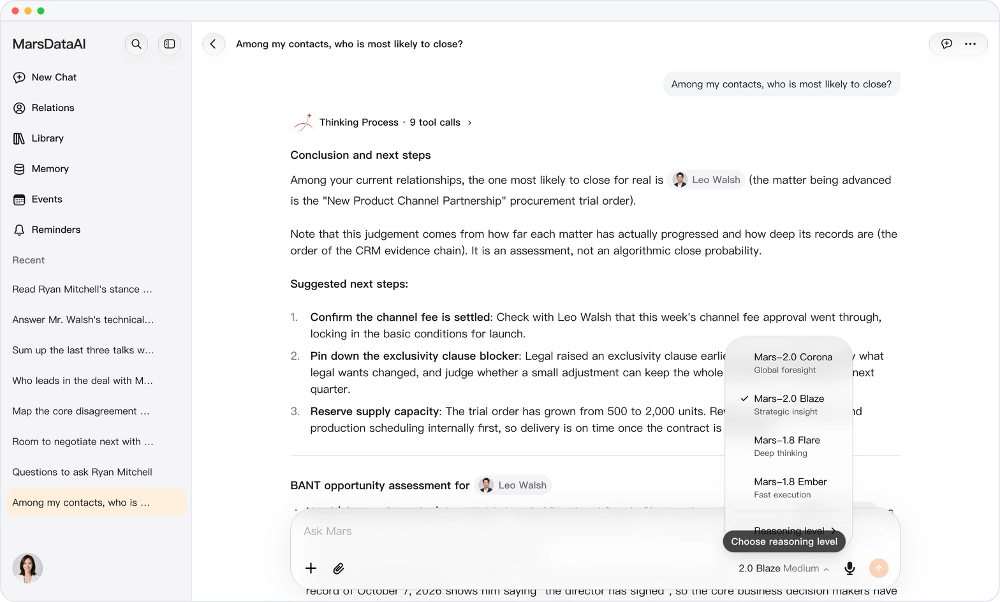
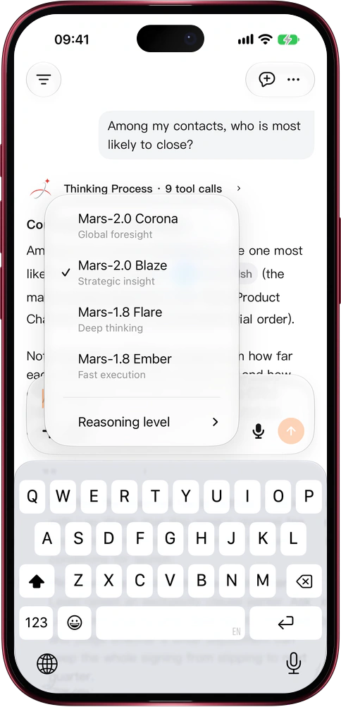

# See the whole board with Mars-2.0 Corona

> **Preview** · 2026-11-11 · `0.1.1.11616`
> These features are available in the preview version and have not been generally released.

A single insight isn't enough when one move shifts three relationships down the line.

Mars-2.0 Corona joins at the top of the composer's model menu, above Mars-2.0 Blaze, Mars-1.8 Flare and Mars-1.8 Ember. Open the model name at the bottom right of the composer, pick Mars-2.0 Corona (global foresight) with Low, Medium or High thinking depth, and send: it connects long conversation histories, files and multi-party context to trace knock-on effects and weigh your options before you act. Switch models anytime without losing the draft in your input box, on the web and in the iOS and Mac apps.

Walk into high-stakes conversations having already thought three moves ahead.

*Illustration using fictional demo data.*

*Illustration using fictional demo data.*

[Explore the preview](https://marsdata.ai/changelog/mars-2-0-corona) · [All updates](../README.md)

[简体中文](./crm-2026-11-11-mars-2-0-corona.zh-CN.md) · [繁體中文](./crm-2026-11-11-mars-2-0-corona.zh-HK.md)
