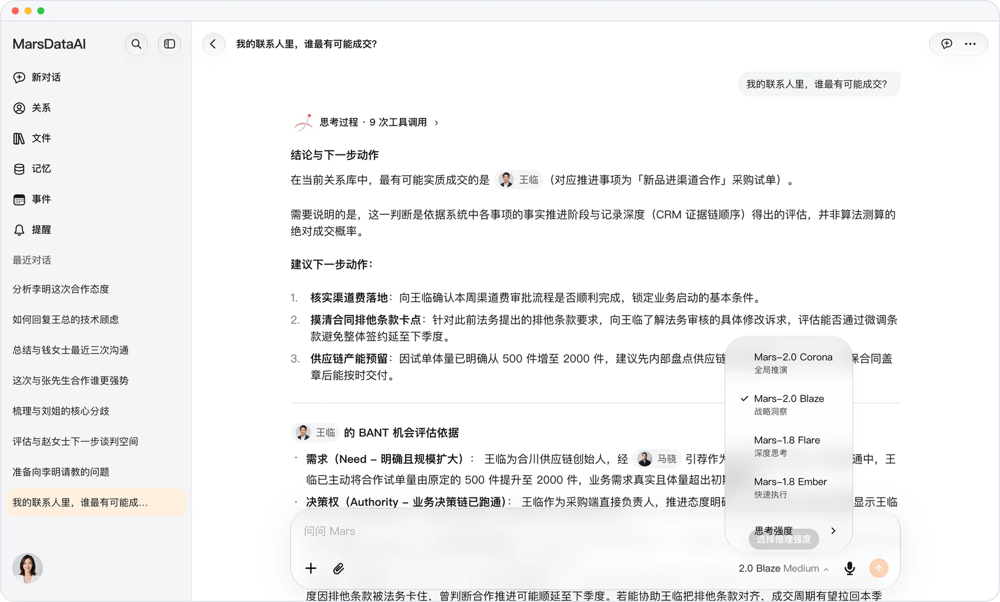

# 复杂局势，先用 Mars-2.0 Corona 推演

> **预览** · 2026-11-11 · `0.1.1.11804`
> 以下功能目前处于预览阶段，尚未正式上线。

牵一发而动全身的局势，光看清眼前这一步远远不够。

Mars-2.0 Corona（日冕 · 全局推演）现已加入输入框右下角的模型菜单，位于 Mars-2.0 Blaze、Mars-1.8 Flare 与 Mars-1.8 Ember 之上。点开模型名称即可选择 Corona，并搭配轻度、中度或深度思考强度：它会把长对话脉络、多份资料与多方关系放在同一盘棋里交叉印证，提前推演不同做法的连锁反应与潜在阻力，再给出分步行动方案。切换模型时已写好的草稿原样保留，不用重打；网页端、iOS 与 Mac 应用同步可用。

关键沟通开口之前，先把后三步棋推演清楚。

*示意图，使用虚构演示数据。*

*示意图，使用虚构演示数据。*

[体验预览版](https://marsdata.ai/changelog/mars-2-0-corona) · [全部更新](../README.zh-CN.md)

[English](./crm-2026-11-11-mars-2-0-corona.md) · [繁體中文](./crm-2026-11-11-mars-2-0-corona.zh-HK.md)
