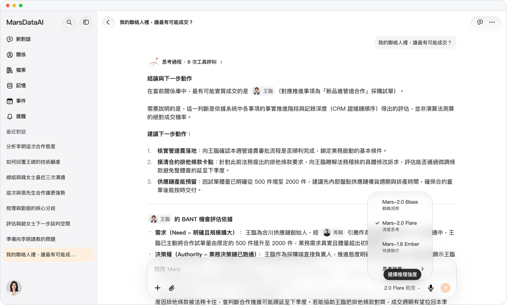
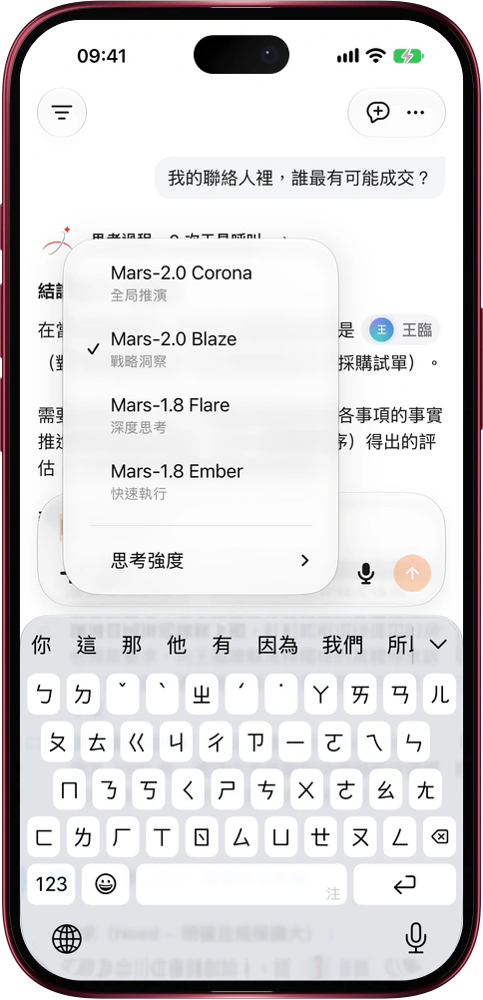

# 複雜局勢，先用 Mars-2.0 Corona 推演

> **預覽** · 2026-11-11 · `0.1.1.11616`
> 以下功能目前處於預覽階段，尚未正式上線。

牽一髮而動全身的局勢，光看清眼前這一步遠遠不夠。

Mars-2.0 Corona（日冕 · 全局推演）現已加入輸入框右下角的模型菜單，位於 Mars-2.0 Blaze、Mars-1.8 Flare 與 Mars-1.8 Ember 之上。點開模型名稱即可選擇 Corona，並搭配輕度、中度或深度思考強度：它會把長對話脈絡、多份資料與多方關係放在同一盤棋裏交叉印證，提前推演不同做法的連鎖反應與潛在阻力，再給出分步行動方案。切換模型時已寫好的草稿原樣保留，不用重打；網頁端、iOS 與 Mac 應用同步可用。

關鍵溝通開口之前，先把後三步棋推演清楚。

*示意圖，使用虛構演示資料。*

*示意圖，使用虛構演示資料。*

[體驗預覽版](https://marsdata.ai/changelog/mars-2-0-corona) · [全部更新](../README.zh-HK.md)

[English](./crm-2026-11-11-mars-2-0-corona.md) · [简体中文](./crm-2026-11-11-mars-2-0-corona.zh-CN.md)
