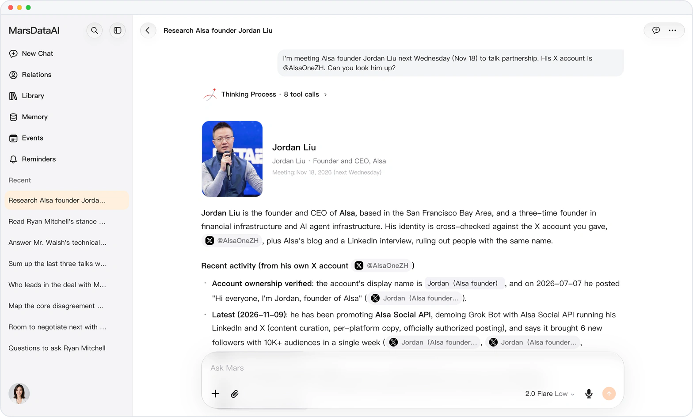
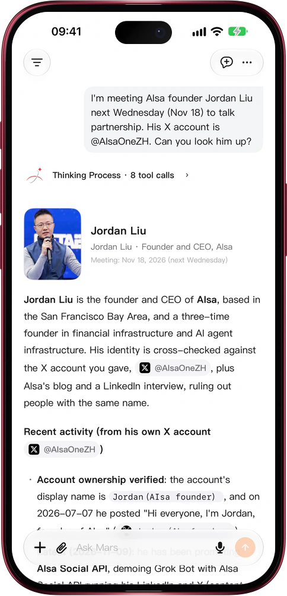

# Photo, name and role, before the answer

> **Preview** · 2026-11-14 · `0.1.1.12210`
> These features are available in the preview version and have not been generally released.

Before you meet someone, hours of research mean nothing if they are about the wrong person.

Ask Mars about a real person, or run deep research around someone, and the answer now opens with a person card: their photo, name, organisation and role, plus up to three lines that frame your question, such as the date you are meeting. The photo comes from the person's own X account once Mars has confirmed it, or else only from an image that names them; with neither, the card shows their initials instead of a guess. One answer carries a card for up to three people, and the card never adds anyone to your contacts. No separate image search, no guessing at faces, on the web, iPhone, iPad and Mac.

Know you have the right person before the conversation starts.

*Illustration using fictional demo data.*

*Illustration using fictional demo data.*

[Explore the preview](https://marsdata.ai/changelog/person-card-in-answers) · [All updates](../README.md)

[简体中文](./crm-2026-11-14-person-card-in-answers.zh-CN.md) · [繁體中文](./crm-2026-11-14-person-card-in-answers.zh-HK.md)
