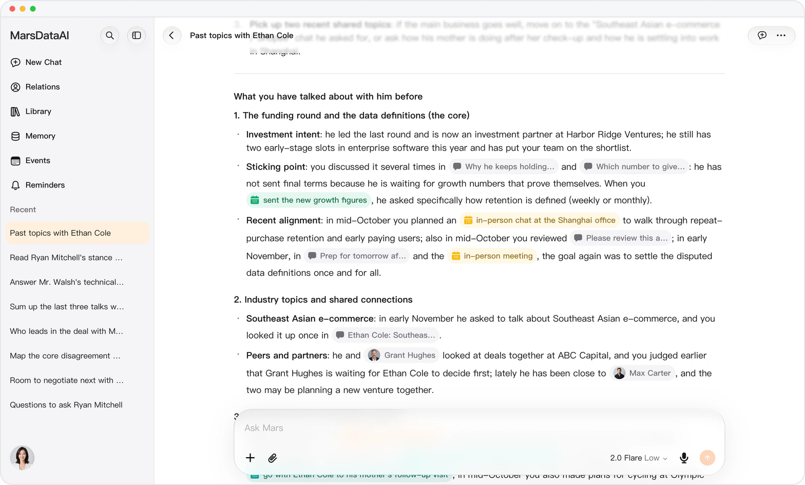
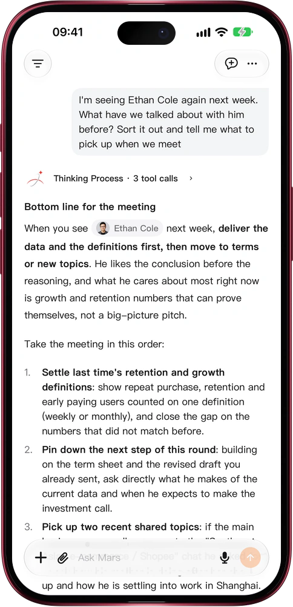

# Name them, and Mars recalls your history

> **Preview** · 2026-11-15 · `0.1.1.12496`
> These features are available in the preview version and have not been generally released.

Everything about one person is spread over a dozen chats. Do you really have to retell it every time?

Ask about someone saved in your relationships by name, and Mars first goes through your other conversations for what was said about that person: the figures you sent, the meetings you planned, the questions they kept asking. It keeps to the person you named and leaves out messages that are only about other contacts, so two people never blur into one answer. In replays of 235 questions that named a contact, the right message reached the top three 93.6% of the time, up from 54.9%, and messages about the wrong person fell from 19.3% to 0. No scrolling back through old chats and no pasting in background, on the web, iPhone, iPad and Mac.

Ask once, get the whole story back, and pick up right where you left off at the next meeting.

*Illustration using fictional demo data.*

*Illustration using fictional demo data.*

[Explore the preview](https://marsdata.ai/changelog/name-someone-mars-remembers) · [All updates](../README.md)

[简体中文](./crm-2026-11-15-name-someone-mars-remembers.zh-CN.md) · [繁體中文](./crm-2026-11-15-name-someone-mars-remembers.zh-HK.md)
