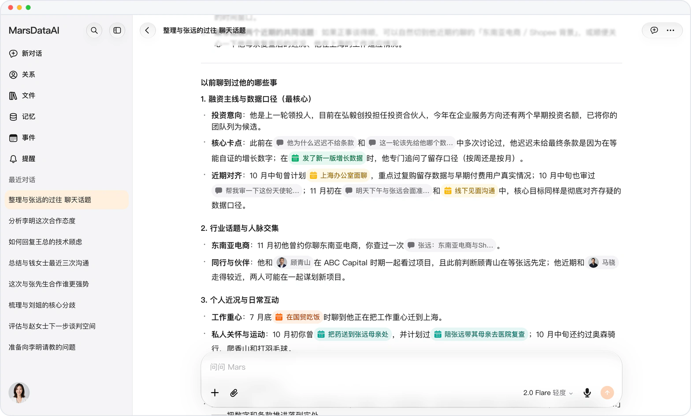
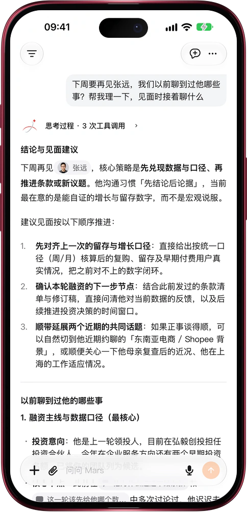

# 提到谁，Mars 先翻出你们聊过的

> **预览** · 2026-11-15 · `0.1.1.12496`
> 以下功能目前处于预览阶段，尚未正式上线。

关于一个人的事，散落在十几段对话里，难道每次都要重讲一遍？

在提问里点名一位已保存的联系人，Mars 会先从你的其他对话里找出关于这个人的内容：你发过的数据、约过的见面、对方反复追问的问题。它只盯住你点名的这个人，只涉及其他联系人的消息一概不拿，两个人的事不会混在一个回答里。在 235 个点名提问的回放测试中，相关消息排进前 3 条的比例从 54.9% 提高到 93.6%，翻出别人消息的比例从 19.3% 降到 0。不用回头翻旧聊天，也不用把背景再粘贴一遍，网页、iPhone、iPad 和 Mac 上都一样。

问一句，和这个人聊过的来龙去脉全回来了，下次见面直接接着聊。

*示意图，使用虚构演示数据。*

*示意图，使用虚构演示数据。*

[体验预览版](https://marsdata.ai/changelog/name-someone-mars-remembers) · [全部更新](../README.zh-CN.md)

[English](./crm-2026-11-15-name-someone-mars-remembers.md) · [繁體中文](./crm-2026-11-15-name-someone-mars-remembers.zh-HK.md)
