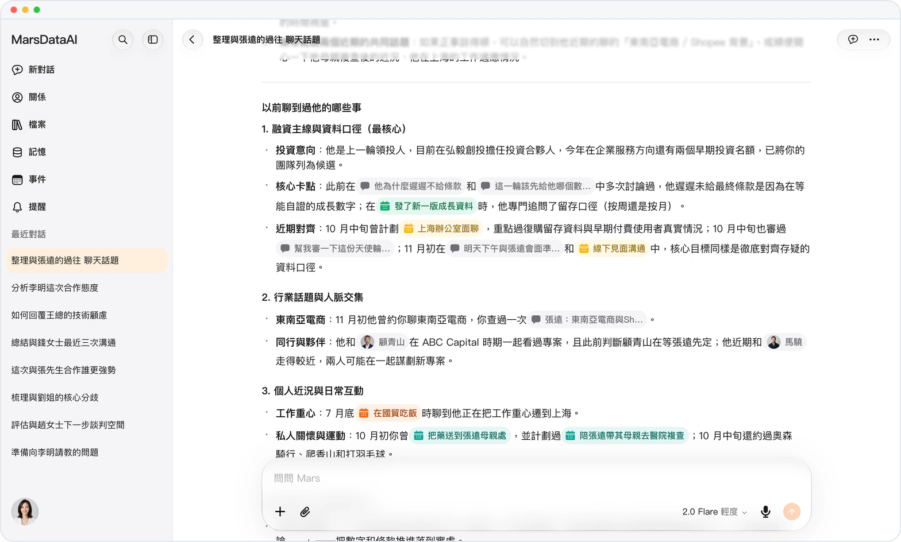
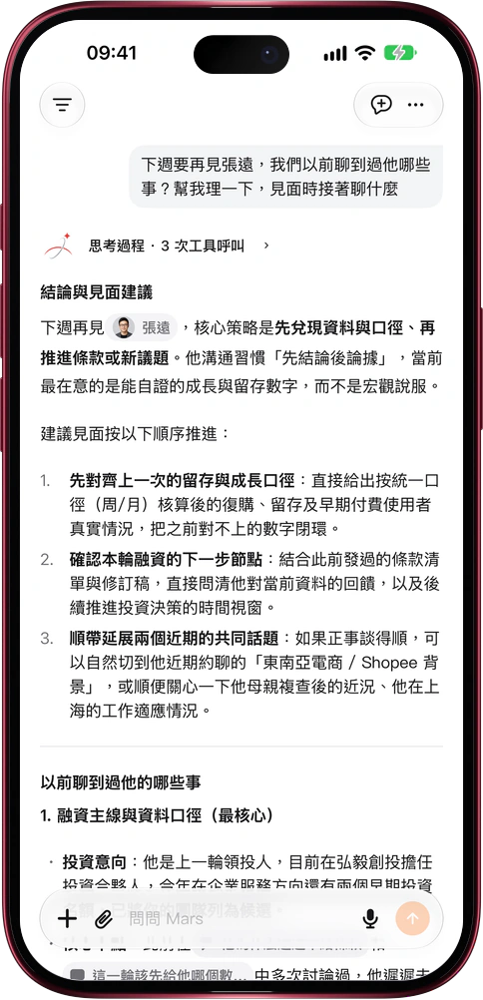

# 提到誰，Mars 先翻出你們聊過的

> **預覽** · 2026-11-15 · `0.1.1.12496`
> 以下功能目前處於預覽階段，尚未正式上線。

關於一個人的事，散落在十幾段對話裏，難道每次都要重講一遍？

在提問裏點名一位已保存的聯繫人，Mars 會先從你的其他對話裏找出關於這個人的內容：你發過的數據、約過的見面、對方反覆追問的問題。它只盯住你點名的這個人，只涉及其他聯繫人的消息一概不拿，兩個人的事不會混在一個回答裏。在 235 個點名提問的回放測試中，相關消息排進前 3 條的比例從 54.9% 提高到 93.6%，翻出別人消息的比例從 19.3% 降到 0。不用回頭翻舊聊天，也不用把背景再粘貼一遍，網頁、iPhone、iPad 和 Mac 上都一樣。

問一句，和這個人聊過的來龍去脈全回來了，下次見面直接接着聊。

*示意圖，使用虛構演示資料。*

*示意圖，使用虛構演示資料。*

[體驗預覽版](https://marsdata.ai/changelog/name-someone-mars-remembers) · [全部更新](../README.zh-HK.md)

[English](./crm-2026-11-15-name-someone-mars-remembers.md) · [简体中文](./crm-2026-11-15-name-someone-mars-remembers.zh-CN.md)
