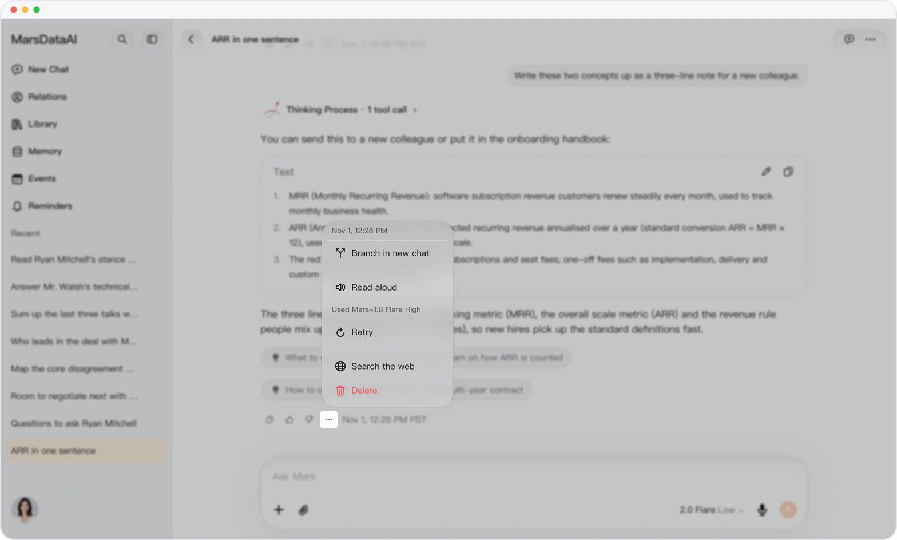
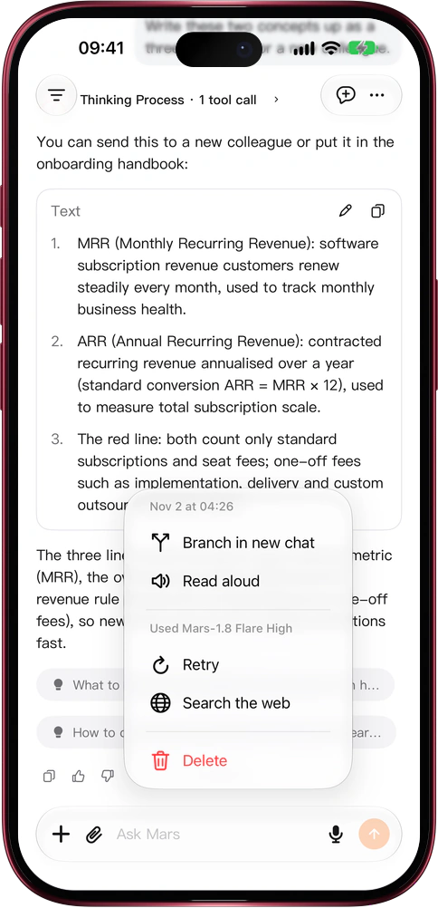

# Delete one exchange, keep the rest

> **Preview** · 2026-11-16 · `0.1.1.12604`
> These features are available in the preview version and have not been generally released.

One off-topic question in a long conversation. Do you really have to delete the whole thing and start over?

Open the more menu under any answer and choose Delete: Mars removes that answer together with the question that led to it, and every other exchange stays exactly where it was. No need to throw away a whole conversation, or start a new one, because of a single detour. When the exchange is the only one in the conversation, Mars asks first, since deleting it means deleting the conversation. It works on the web, iPhone, iPad and Mac.

Keep every conversation on topic, so it reads cleanly whenever you come back to it.

*Illustration using fictional demo data.*

*Illustration using fictional demo data.*

[Explore the preview](https://marsdata.ai/changelog/delete-one-exchange) · [All updates](../README.md)

[简体中文](./crm-2026-11-16-delete-one-exchange.zh-CN.md) · [繁體中文](./crm-2026-11-16-delete-one-exchange.zh-HK.md)
