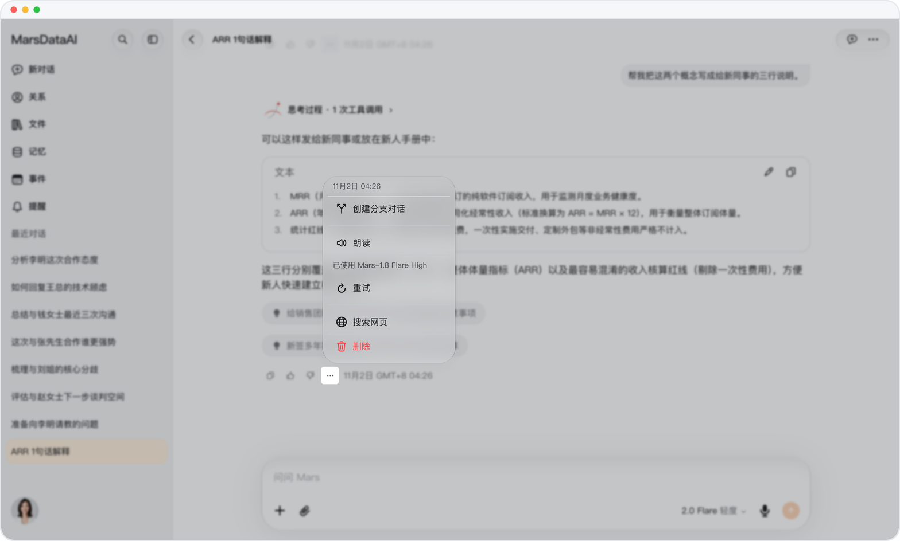
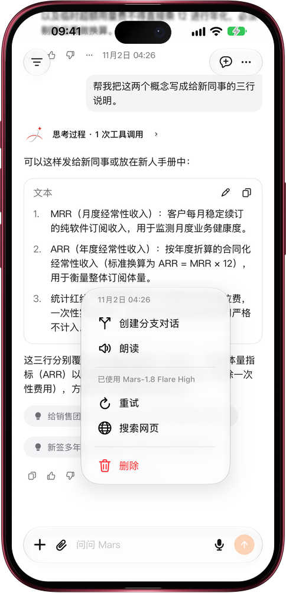

# 问偏了一轮？单独删掉，对话还在

> **预览** · 2026-11-16 · `0.1.1.12604`
> 以下功能目前处于预览阶段，尚未正式上线。

一段聊得好好的对话，中间夹了一轮问偏的，难道只能整段删掉重来？

在任意一条回答下打开更多菜单，选「删除」：Mars 删掉这条回答和引出它的那个问题，其余每一轮问答原地不动。不用因为一次跑题就整段对话作废，也不用另开新对话从头再聊。如果这一问一答是整段对话里唯一的一轮，Mars 会先问你，因为删掉它就等于删掉整段对话。网页、iPhone、iPad 和 Mac 上都能用。

每段对话只留有用的内容，回头翻看、接着往下问都更清爽。

*示意图，使用虚构演示数据。*

*示意图，使用虚构演示数据。*

[体验预览版](https://marsdata.ai/changelog/delete-one-exchange) · [全部更新](../README.zh-CN.md)

[English](./crm-2026-11-16-delete-one-exchange.md) · [繁體中文](./crm-2026-11-16-delete-one-exchange.zh-HK.md)
