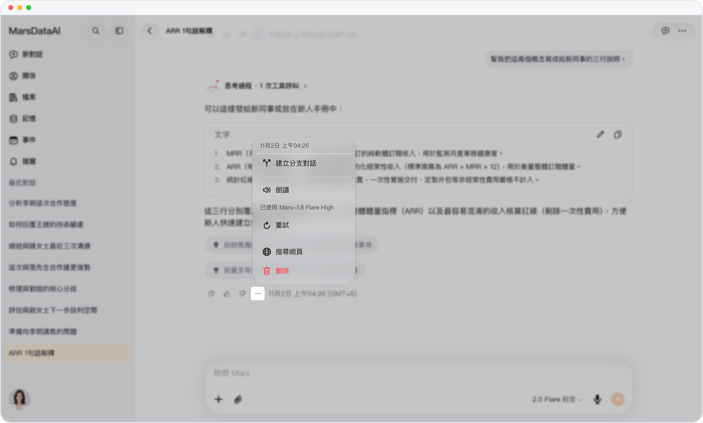
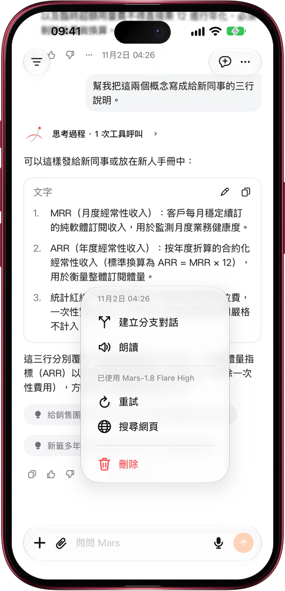

# 問偏了一輪？單獨刪掉，對話還在

> **預覽** · 2026-11-16 · `0.1.1.12604`
> 以下功能目前處於預覽階段，尚未正式上線。

一段聊得好好的對話，中間夾了一輪問偏的，難道只能整段刪掉重來？

在任意一條回答下打開更多菜單，選「刪除」：Mars 刪掉這條回答和引出它的那個問題，其餘每一輪問答原地不動。不用因為一次跑題就整段對話作廢，也不用另開新對話從頭再聊。如果這一問一答是整段對話裏唯一的一輪，Mars 會先問你，因為刪掉它就等於刪掉整段對話。網頁、iPhone、iPad 和 Mac 上都能用。

每段對話只留有用的內容，回頭翻看、接着往下問都更清爽。

*示意圖，使用虛構演示資料。*

*示意圖，使用虛構演示資料。*

[體驗預覽版](https://marsdata.ai/changelog/delete-one-exchange) · [全部更新](../README.zh-HK.md)

[English](./crm-2026-11-16-delete-one-exchange.md) · [简体中文](./crm-2026-11-16-delete-one-exchange.zh-CN.md)
