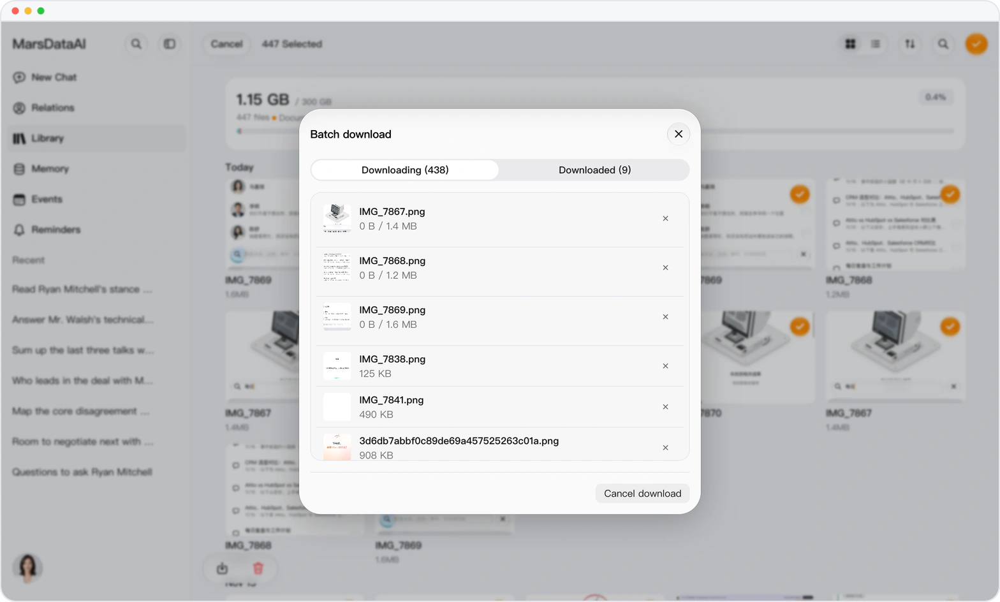
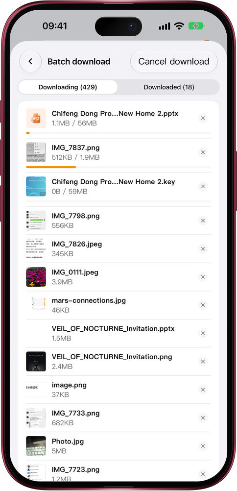

# Download hundreds, track the progress

> **Preview** · 2026-11-16 · `0.1.1.12604`
> These features are available in the preview version and have not been generally released.

Need a copy of everything in your Library? Clicking files one at a time, or staring at a spinner, wears thin fast.

Select files in the Library, or Select all, and choose Download: the Batch download window lists every file under Downloading and Downloaded, each with its size, bytes received and a progress bar. Mars fetches three files at a time; cancel whenever you like, Resume picks up from where it stopped, and only the files that failed are retried. On a computer, pick the folder to save to and make it the default in browsers that allow it; on iPhone, iPad and Mac, save to a folder or share the finished files. Files with the same name are never overwritten. In testing, all 544 files of a Select all finished downloading.

Back up a project or hand over a whole batch of files in one go, always knowing how far along it is.

*Illustration using fictional demo data.*

*Illustration using fictional demo data.*

[Explore the preview](https://marsdata.ai/changelog/library-batch-download) · [All updates](../README.md)

[简体中文](./crm-2026-11-16-library-batch-download.zh-CN.md) · [繁體中文](./crm-2026-11-16-library-batch-download.zh-HK.md)
