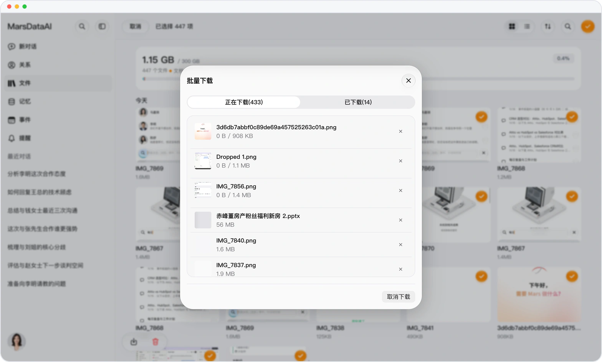
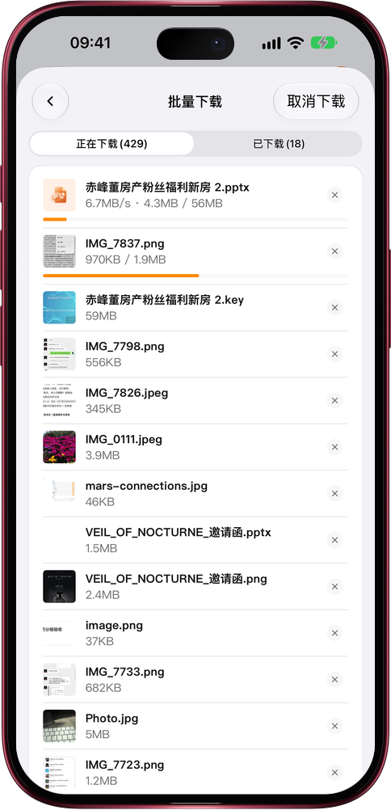

# 几百个文件一次下完，进度一目了然

> **预览** · 2026-11-16 · `0.1.1.12604`
> 以下功能目前处于预览阶段，尚未正式上线。

想把资料库里的文件都存一份？一个个点下载，或者对着转圈干等，太磨人了。

在资料库里选中文件，或者直接「全选」，点「下载」：「批量下载」窗口把每个文件分进「正在下载」和「已下载」，逐个显示大小、已下载字节和进度条。Mars 每次同时下载 3 个文件；随时可以取消，「继续下载」从停下的地方接着来，失败的文件单独重试即可。在电脑上，支持的浏览器可以先选好保存的文件夹并设为默认路径；在 iPhone、iPad 和 Mac 上，可以存到文件夹或直接分享。同名文件不会被覆盖。实测一次全选 544 个文件，全部下载完成。

整批文件一次拿到手，备份、交接都省心，进度始终心里有数。

*示意图，使用虚构演示数据。*

*示意图，使用虚构演示数据。*

[体验预览版](https://marsdata.ai/changelog/library-batch-download) · [全部更新](../README.zh-CN.md)

[English](./crm-2026-11-16-library-batch-download.md) · [繁體中文](./crm-2026-11-16-library-batch-download.zh-HK.md)
