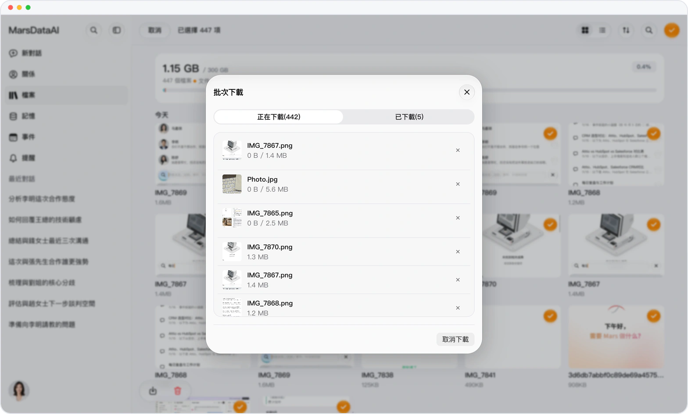
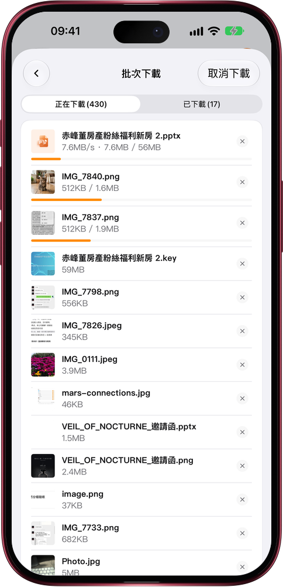

# 幾百個文件一次下完，進度一目瞭然

> **預覽** · 2026-11-16 · `0.1.1.12604`
> 以下功能目前處於預覽階段，尚未正式上線。

想把資料庫裏的文件都存一份？一個個點下載，或者對着轉圈乾等，太磨人了。

在資料庫裏選中文件，或者直接「全選」，點「下載」：「批量下載」窗口把每個文件分進「正在下載」和「已下載」，逐個顯示大小、已下載字節和進度條。Mars 每次同時下載 3 個文件；隨時可以取消，「繼續下載」從停下的地方接着來，失敗的文件單獨重試即可。在電腦上，支持的瀏覽器可以先選好保存的文件夾並設為默認路徑；在 iPhone、iPad 和 Mac 上，可以存到文件夾或直接分享。同名文件不會被覆蓋。實測一次全選 544 個文件，全部下載完成。

整批文件一次拿到手，備份、交接都省心，進度始終心裏有數。

*示意圖，使用虛構演示資料。*

*示意圖，使用虛構演示資料。*

[體驗預覽版](https://marsdata.ai/changelog/library-batch-download) · [全部更新](../README.zh-HK.md)

[English](./crm-2026-11-16-library-batch-download.md) · [简体中文](./crm-2026-11-16-library-batch-download.zh-CN.md)
