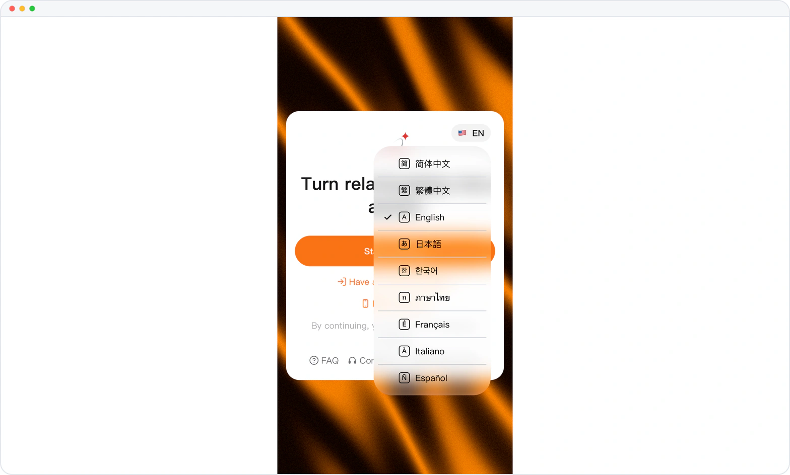
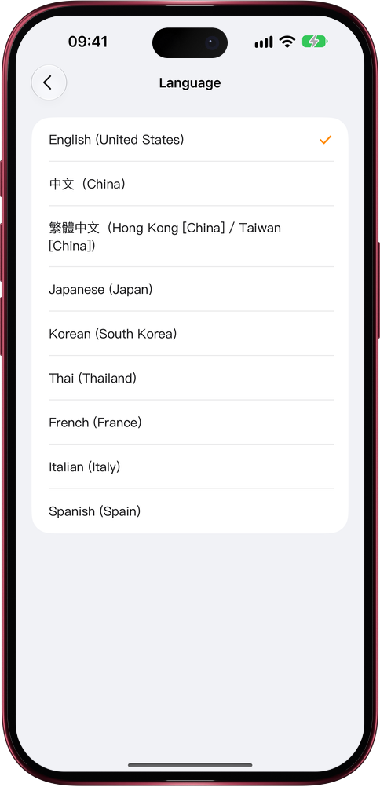

# Mars in Français, Italiano and Español

> **Preview** · 2026-11-17 · `0.1.1.12748`
> These features are available in the preview version and have not been generally released.

When an app is not in your language, every button costs a moment of translation.

Settings › Language now lists Français, Italiano and Español, on the web and in the iOS app on iPhone, iPad and Mac. On first launch Mars follows your device language, so a French, Italian or Spanish device opens straight into it. The whole app switches: onboarding, menus, the home greeting, permission prompts, Siri phrases, widgets and the share action, with dates written the way each language writes them. When Mars asks how long a goal should run, the choices come in your language too, and a new field Mars saves on a contact is named in it. Anything not translated yet reads English, never Chinese. No second language to lean on, no guessing at buttons: Mars works the way you think.

From the first screen, you read and work with Mars in your own language.

*Illustration using fictional demo data.*

*Illustration using fictional demo data.*

[Explore the preview](https://marsdata.ai/changelog/french-italian-spanish) · [All updates](../README.md)

[简体中文](./crm-2026-11-17-french-italian-spanish.zh-CN.md) · [繁體中文](./crm-2026-11-17-french-italian-spanish.zh-HK.md)
