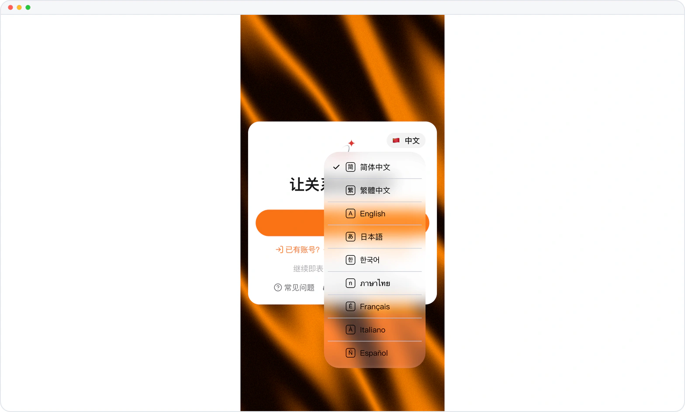
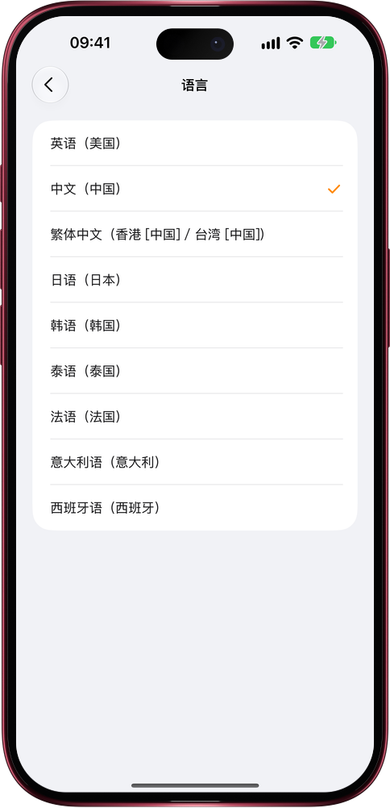

# 法语、意大利语、西班牙语用户，打开就是母语

> **预览** · 2026-11-17 · `0.1.1.12748`
> 以下功能目前处于预览阶段，尚未正式上线。

用不是母语的应用，每个按钮都得先在脑子里翻译一遍。

「设置 › 语言」里新增了 Français、Italiano 和 Español，网页版和 iPhone、iPad、Mac 上的 iOS 应用都能选。首次打开时 Mars 跟随设备语言，法语、意大利语、西班牙语设备一打开就是母语界面。整个应用一起切换：引导页、菜单、首页问候、权限提示、Siri 短语、小组件和分享入口，日期也按各语言的习惯书写。Mars 问你目标要定多长期限时，选项同样是你的语言；Mars 给联系人新记的信息，名称也用你的语言。还没翻译到的文字显示英文，绝不会冒出中文。不用借第二语言，也不用猜按钮：Mars 跟着你的思路走。

从第一屏开始，用母语和 Mars 一起做事。

*示意图，使用虚构演示数据。*

*示意图，使用虚构演示数据。*

[体验预览版](https://marsdata.ai/changelog/french-italian-spanish) · [全部更新](../README.zh-CN.md)

[English](./crm-2026-11-17-french-italian-spanish.md) · [繁體中文](./crm-2026-11-17-french-italian-spanish.zh-HK.md)
