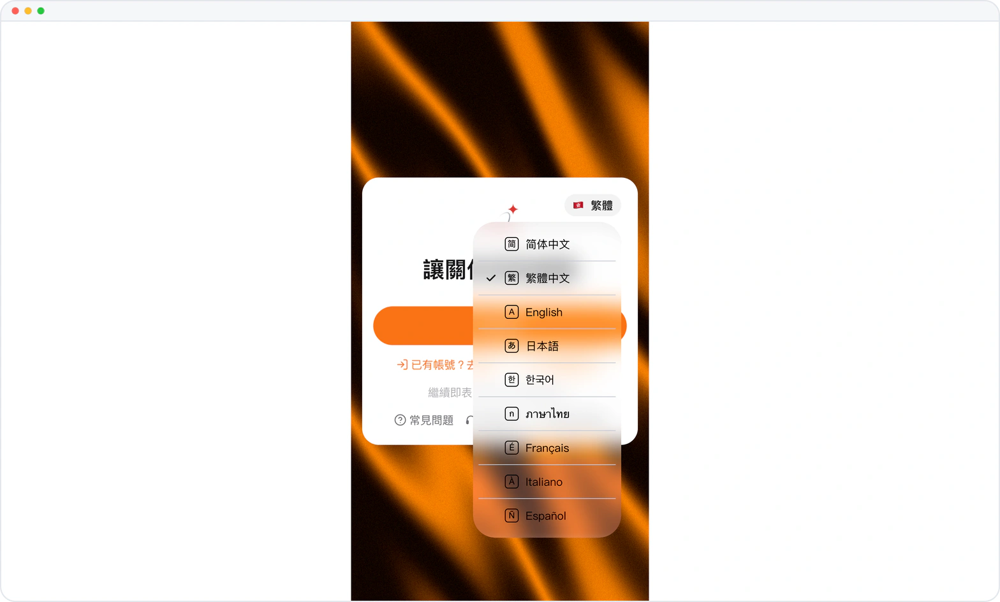
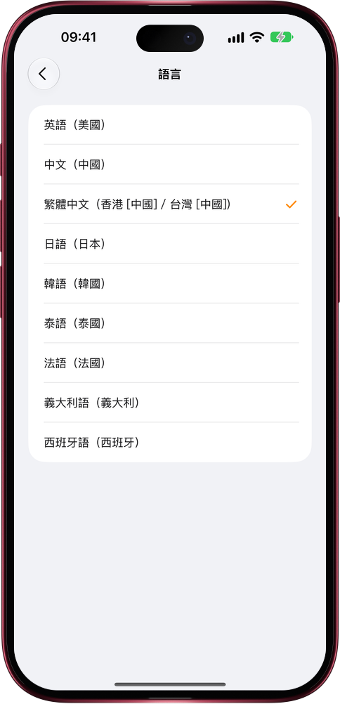

# 法語、意大利語、西班牙語用户，打開就是母語

> **預覽** · 2026-11-17 · `0.1.1.12748`
> 以下功能目前處於預覽階段，尚未正式上線。

用不是母語的應用，每個按鈕都得先在腦子裏翻譯一遍。

「設置 › 語言」裏新增了 Français、Italiano 和 Español，網頁版和 iPhone、iPad、Mac 上的 iOS 應用都能選。首次打開時 Mars 跟隨設備語言，法語、意大利語、西班牙語設備一打開就是母語界面。整個應用一起切換：引導頁、菜單、首頁問候、權限提示、Siri 短語、小組件和分享入口，日期也按各語言的習慣書寫。Mars 問你目標要定多長期限時，選項同樣是你的語言；Mars 給聯繫人新記的信息，名稱也用你的語言。還沒翻譯到的文字顯示英文，絕不會冒出中文。不用借第二語言，也不用猜按鈕：Mars 跟着你的思路走。

從第一屏開始，用母語和 Mars 一起做事。

*示意圖，使用虛構演示資料。*

*示意圖，使用虛構演示資料。*

[體驗預覽版](https://marsdata.ai/changelog/french-italian-spanish) · [全部更新](../README.zh-HK.md)

[English](./crm-2026-11-17-french-italian-spanish.md) · [简体中文](./crm-2026-11-17-french-italian-spanish.zh-CN.md)
