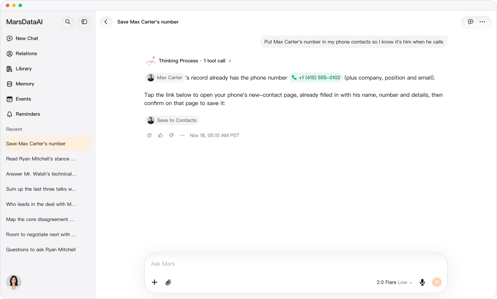
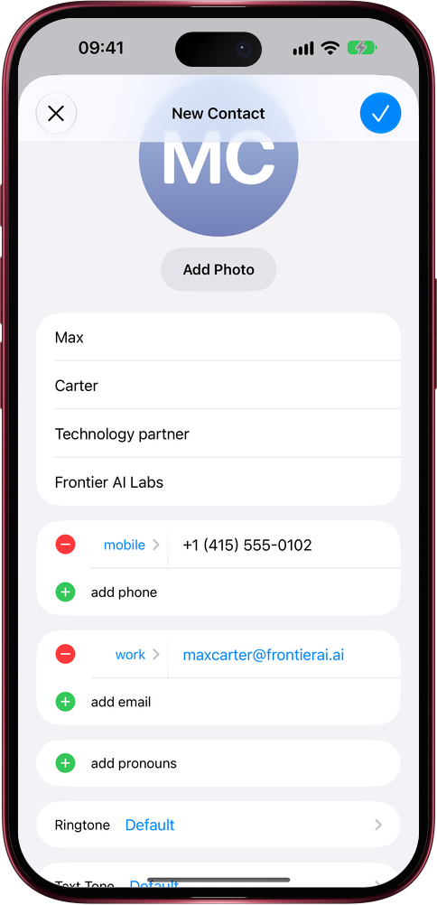

# See their name when they call

> **Preview** · 2026-11-18 · `0.1.1.12835`
> These features are available in the preview version and have not been generally released.

The number is saved in Mars, yet their call still rings as an unknown number.

In the Mars app on iPhone, iPad and Mac, tell Mars you want someone in your phone contacts. Mars first saves the number and any details you gave on their record, then replies with a Save to Contacts link. Tap it and the system new-contact page opens, already filled in with the name, phone numbers, emails, company and position Mars holds. If you have let Mars read your contacts and one already has that number, Mars opens that contact instead, so you don't end up with a duplicate. You confirm and save on the system page; Mars never writes to your address book by itself. No copying digits between apps, no typing a name twice.

Next time they call, you see their name before you pick up.

*Illustration using fictional demo data.*

*Illustration using fictional demo data.*

[Explore the preview](https://marsdata.ai/changelog/save-to-phone-contacts) · [All updates](../README.md)

[简体中文](./crm-2026-11-18-save-to-phone-contacts.zh-CN.md) · [繁體中文](./crm-2026-11-18-save-to-phone-contacts.zh-HK.md)
