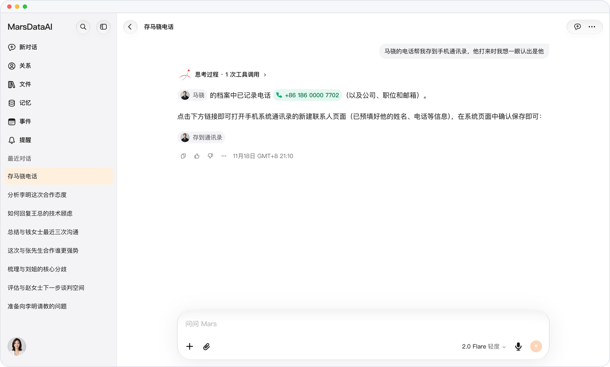
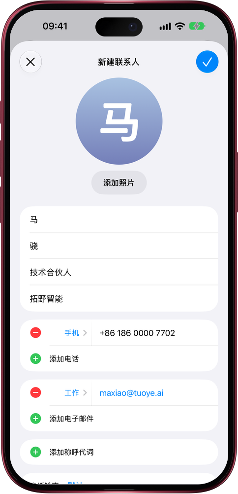

# 存进手机通讯录，来电一眼认出是谁

> **预览** · 2026-11-18 · `0.1.1.12835`
> 以下功能目前处于预览阶段，尚未正式上线。

号码明明记在 Mars 里，对方打来时，手机上还是一串陌生数字。

在 iPhone、iPad 和 Mac 上的 Mars 应用里，告诉 Mars 你想把某人存进手机通讯录。Mars 先把号码和你提到的其他信息记进他的档案，再回你一个「存到通讯录」链接。点开就是系统的新建联系人页面，姓名、电话、邮箱、公司和职位都已按 Mars 的记录填好。如果你允许过 Mars 读取通讯录，而且已有联系人用着这个号码，Mars 会直接打开那位联系人，不会多出一条重复。最后在系统页面上由你确认保存，Mars 从不自己改动你的通讯录。不用在两个应用之间抄号码，也不用把名字再敲一遍。

下次对方来电，接起之前就知道是谁。

*示意图，使用虚构演示数据。*

*示意图，使用虚构演示数据。*

[体验预览版](https://marsdata.ai/changelog/save-to-phone-contacts) · [全部更新](../README.zh-CN.md)

[English](./crm-2026-11-18-save-to-phone-contacts.md) · [繁體中文](./crm-2026-11-18-save-to-phone-contacts.zh-HK.md)
