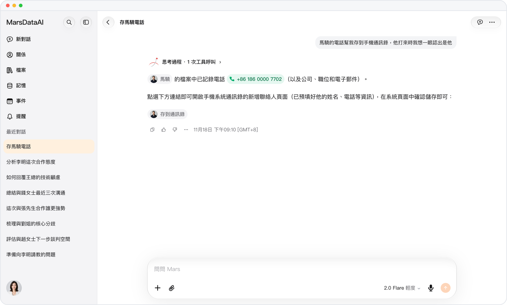
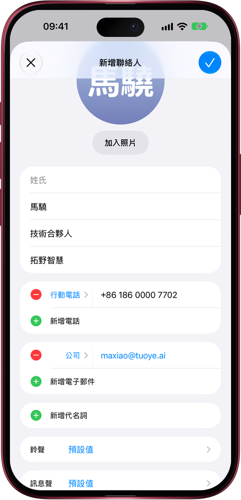

# 存進手機通訊錄，來電一眼認出是誰

> **預覽** · 2026-11-18 · `0.1.1.12835`
> 以下功能目前處於預覽階段，尚未正式上線。

號碼明明記在 Mars 裏，對方打來時，手機上還是一串陌生數字。

在 iPhone、iPad 和 Mac 上的 Mars 應用裏，告訴 Mars 你想把某人存進手機通訊錄。Mars 先把號碼和你提到的其他信息記進他的檔案，再回你一個「存到通訊錄」鏈接。點開就是系統的新建聯繫人頁面，姓名、電話、郵箱、公司和職位都已按 Mars 的記錄填好。如果你允許過 Mars 讀取通訊錄，而且已有聯繫人用着這個號碼，Mars 會直接打開那位聯繫人，不會多出一條重複。最後在系統頁面上由你確認保存，Mars 從不自己改動你的通訊錄。不用在兩個應用之間抄號碼，也不用把名字再敲一遍。

下次對方來電，接起之前就知道是誰。

*示意圖，使用虛構演示資料。*

*示意圖，使用虛構演示資料。*

[體驗預覽版](https://marsdata.ai/changelog/save-to-phone-contacts) · [全部更新](../README.zh-HK.md)

[English](./crm-2026-11-18-save-to-phone-contacts.md) · [简体中文](./crm-2026-11-18-save-to-phone-contacts.zh-CN.md)
