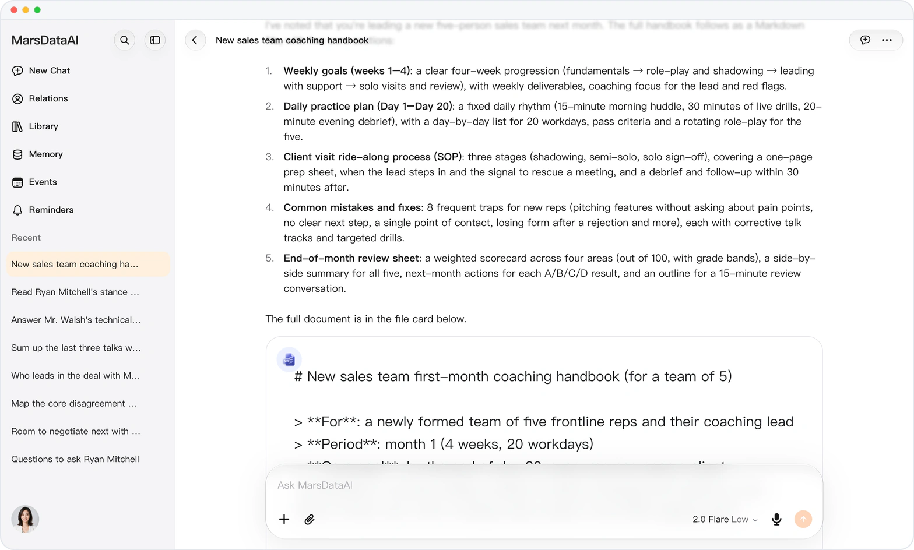
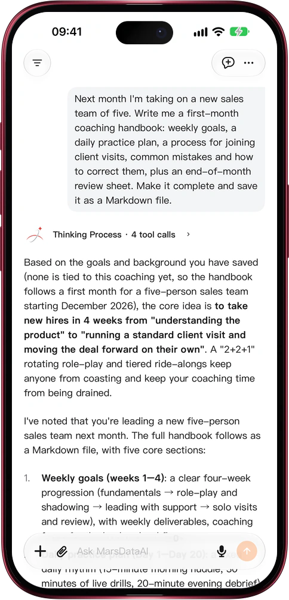

# The answer first, the file after

> **Preview** · 2026-11-19 · `0.1.1.13350`
> These features are available in the preview version and have not been generally released.

Ask for a long report and you used to stare at an empty reply for minutes.

Choose Mars-2.0 Blaze and ask for a long file: a report, an analysis, a plan, a list or meeting minutes. Mars now writes its answer first, with the conclusions and what the file will hold, then saves the file in the same reply and shows its card below. Before, the first words came only after the whole file was written, about 267 seconds on a long plan; now they arrive in under a minute. The file still covers everything you asked for, and the request costs the same credits. Other models keep saving the file first.

Read the key points and plan your next move while the file is still being written.

*Illustration using fictional demo data.*

*Illustration using fictional demo data.*

[Explore the preview](https://marsdata.ai/changelog/long-files-answer-first) · [All updates](../README.md)

[简体中文](./crm-2026-11-19-long-files-answer-first.zh-CN.md) · [繁體中文](./crm-2026-11-19-long-files-answer-first.zh-HK.md)
