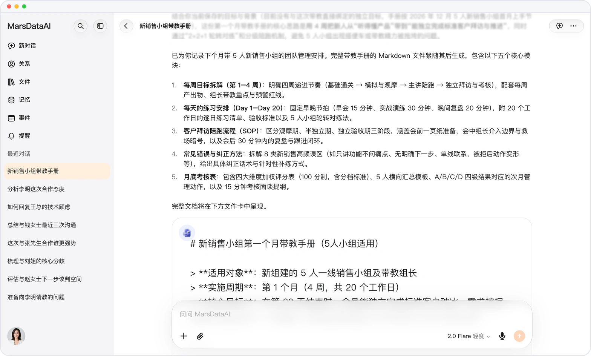
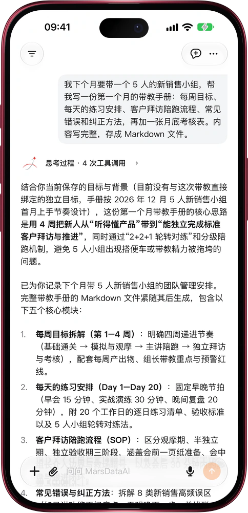

# 长文件不用干等，结论先到

> **预览** · 2026-11-19 · `0.1.1.13350`
> 以下功能目前处于预览阶段，尚未正式上线。

让 Mars 写一份长报告，过去要对着空白的回复干等好几分钟。

选 Mars-2.0 Blaze，让它写一份长文件：报告、分析、方案、清单或会议纪要都算。现在 Mars 先回答，把结论和文件里会有什么先写给你，再在同一条回复里保存文件，文件卡片出现在下方。过去要等整份文件写完才出第一个字，一份长方案约 267 秒；现在 1 分钟以内就能读到。文件内容一样完整，消耗的积分也不变。其他模型仍是先存文件、再回答。

文件还在写，你已经读完要点、想好下一步。

*示意图，使用虚构演示数据。*

*示意图，使用虚构演示数据。*

[体验预览版](https://marsdata.ai/changelog/long-files-answer-first) · [全部更新](../README.zh-CN.md)

[English](./crm-2026-11-19-long-files-answer-first.md) · [繁體中文](./crm-2026-11-19-long-files-answer-first.zh-HK.md)
