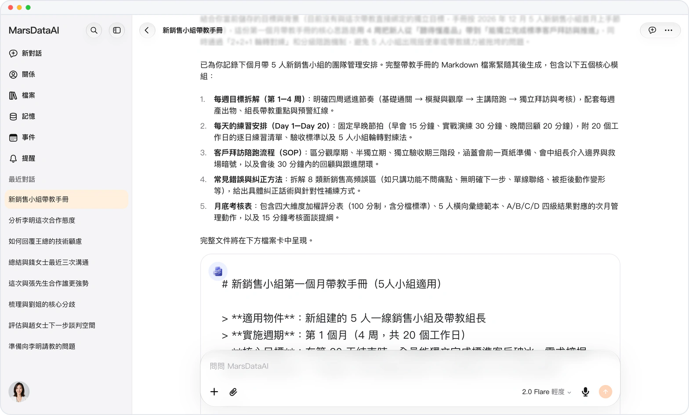
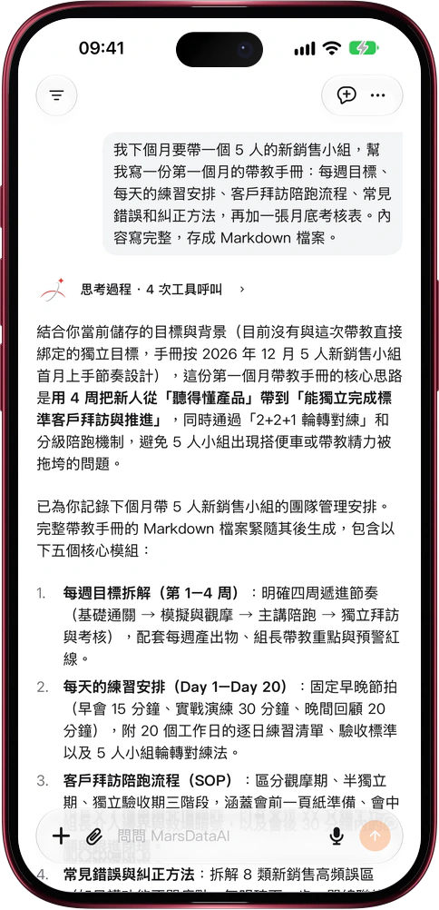

# 長文件不用幹等，結論先到

> **預覽** · 2026-11-19 · `0.1.1.13350`
> 以下功能目前處於預覽階段，尚未正式上線。

讓 Mars 寫一份長報告，過去要對着空白的回覆乾等好幾分鐘。

選 Mars-2.0 Blaze，讓它寫一份長文件：報告、分析、方案、清單或會議紀要都算。現在 Mars 先回答，把結論和文件裏會有什麼先寫給你，再在同一條回覆裏保存文件，文件卡片出現在下方。過去要等整份文件寫完才出第一個字，一份長方案約 267 秒；現在 1 分鐘以內就能讀到。文件內容一樣完整，消耗的積分也不變。其他模型仍是先存文件、再回答。

文件還在寫，你已經讀完要點、想好下一步。

*示意圖，使用虛構演示資料。*

*示意圖，使用虛構演示資料。*

[體驗預覽版](https://marsdata.ai/changelog/long-files-answer-first) · [全部更新](../README.zh-HK.md)

[English](./crm-2026-11-19-long-files-answer-first.md) · [简体中文](./crm-2026-11-19-long-files-answer-first.zh-CN.md)
