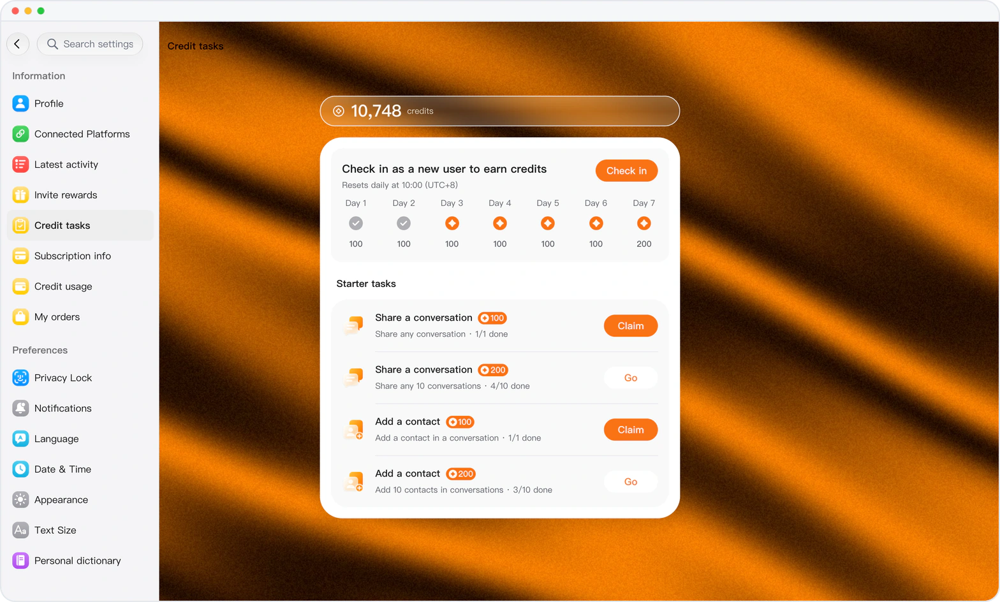
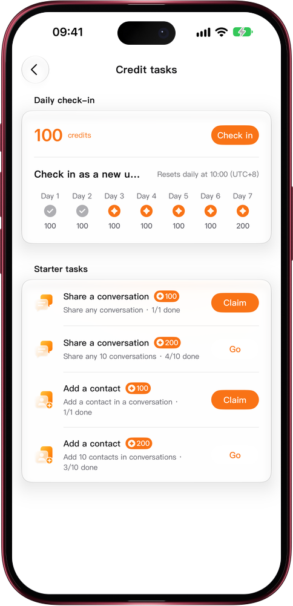

# New here? A daily check-in pays you

> **Preview** · 2026-11-20 · `0.1.1.13579`
> These features are available in the preview version and have not been generally released.

You just joined and want to try everything, without watching every credit.

For your first 30 days, Newcomer rewards waits at the top right of the new-chat page, and Credit tasks sits in Settings. Check in once a day: 100 credits on days one to six and 200 on day seven, 800 credits for a full week. Miss a day and the run starts again at day one; the day resets at 10:00 (UTC+8). Four starter tasks pay too: share a conversation for 100 credits, share 10 for 200, add a contact in a conversation for 100, add 10 for 200. Tap Claim and the credits land at once. No subscription and no invitations needed: the things you already do in Mars earn them. It works on the web and in the app on iPhone, iPad and Mac, and reward credits stay in your balance when your plan renews.

More room to explore your first month, and Mars becomes a habit before you think about plans.

*Illustration using fictional demo data.*

*Illustration using fictional demo data.*

[Explore the preview](https://marsdata.ai/changelog/newcomer-check-in-rewards) · [All updates](../README.md)

[简体中文](./crm-2026-11-20-newcomer-check-in-rewards.zh-CN.md) · [繁體中文](./crm-2026-11-20-newcomer-check-in-rewards.zh-HK.md)
