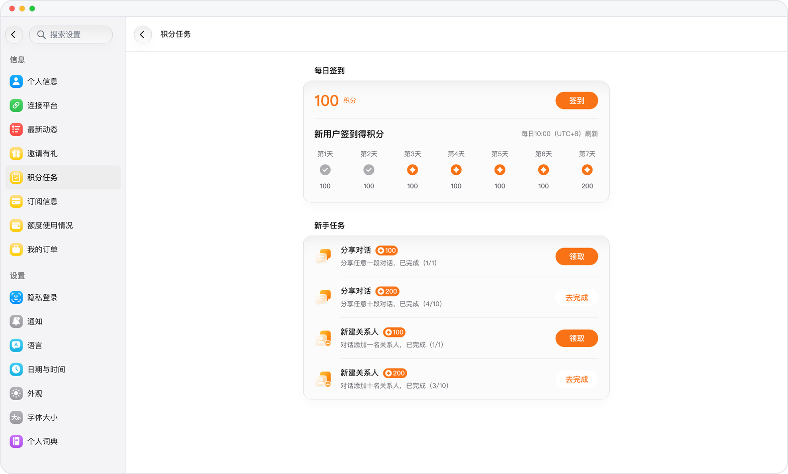
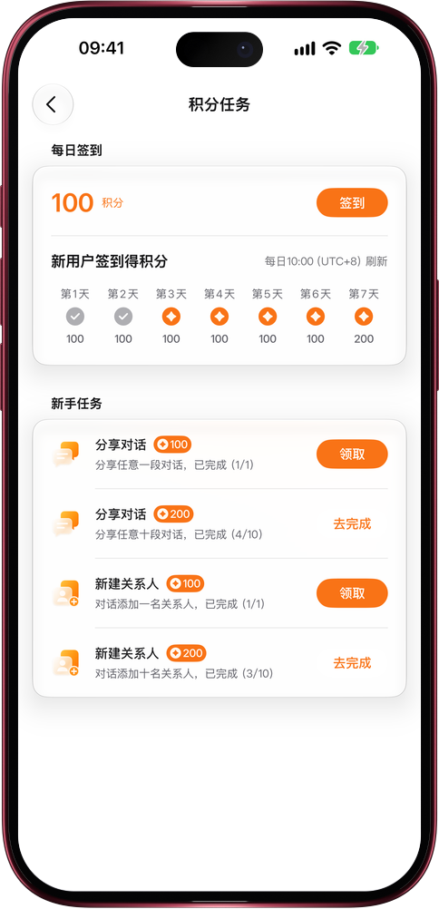

# 新用户每天签到，积分天天到账

> **预览** · 2026-11-20 · `0.1.1.13579`
> 以下功能目前处于预览阶段，尚未正式上线。

刚开始用 Mars，想多问多试，又怕积分不够花？

注册后的 30 天内，新对话页右上角会出现「领新人福利」，设置里也有「积分任务」。每天签到一次：前 6 次各领 100 积分，第 7 次领 200，累计签满 7 次共 800 积分；中间断签也不清零，每天 10:00（UTC+8）刷新。还有四个新手任务：分享 1 段对话领 100，分享 10 段领 200，在对话里添加 1 位关系人领 100，添加 10 位领 200，点「领取」立即到账。不用订阅，也不用拉人，平时本来就会做的事，顺手就把积分攒下了。网页版和 iPhone、iPad、Mac 应用都能领，奖励积分在套餐续费时也不清零。

头一个月放开问、放开试，把 Mars 用成习惯。

*示意图，使用虚构演示数据。*

*示意图，使用虚构演示数据。*

[体验预览版](https://marsdata.ai/changelog/newcomer-check-in-rewards) · [全部更新](../README.zh-CN.md)

[English](./crm-2026-11-20-newcomer-check-in-rewards.md) · [繁體中文](./crm-2026-11-20-newcomer-check-in-rewards.zh-HK.md)
