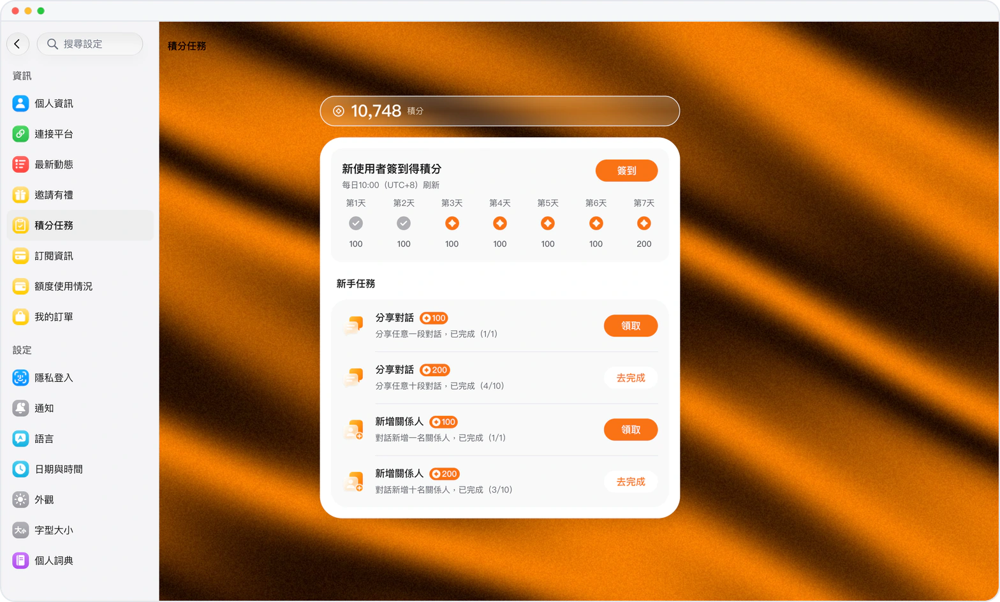
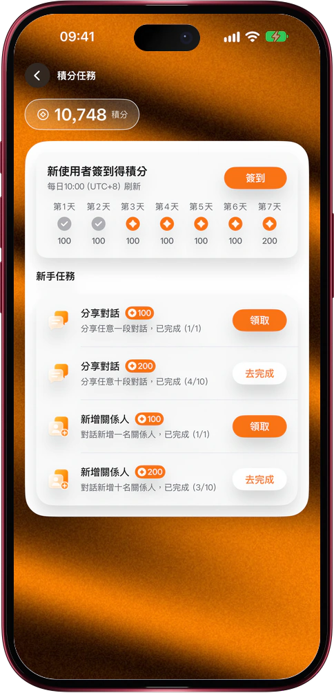

# 新用户每天簽到，積分天天到賬

> **預覽** · 2026-11-20 · `0.1.1.13579`
> 以下功能目前處於預覽階段，尚未正式上線。

剛開始用 Mars，想多問多試，又怕積分不夠花？

註冊後的 30 天內，新對話頁右上角會出現「領新人福利」，設置裏也有「積分任務」。每天簽到一次：第 1 到第 6 天各領 100 積分，第 7 天領 200，連續 7 天共 800 積分；斷籤一天就從第 1 天重新算，每天 10:00（UTC+8）刷新。還有四個新手任務：分享 1 段對話領 100，分享 10 段領 200，在對話裏添加 1 位關係人領 100，添加 10 位領 200，點「領取」立即到賬。不用訂閲，也不用拉人，平時本來就會做的事，順手就把積分攢下了。網頁版和 iPhone、iPad、Mac 應用都能領，獎勵積分在套餐續費時也不清零。

頭一個月放開問、放開試，把 Mars 用成習慣。

*示意圖，使用虛構演示資料。*

*示意圖，使用虛構演示資料。*

[體驗預覽版](https://marsdata.ai/changelog/newcomer-check-in-rewards) · [全部更新](../README.zh-HK.md)

[English](./crm-2026-11-20-newcomer-check-in-rewards.md) · [简体中文](./crm-2026-11-20-newcomer-check-in-rewards.zh-CN.md)
