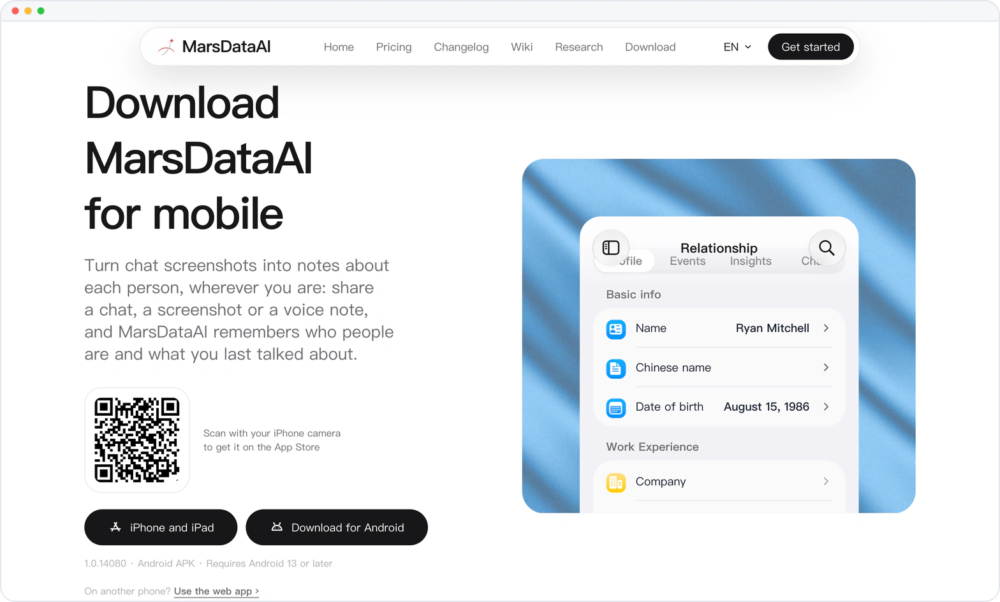
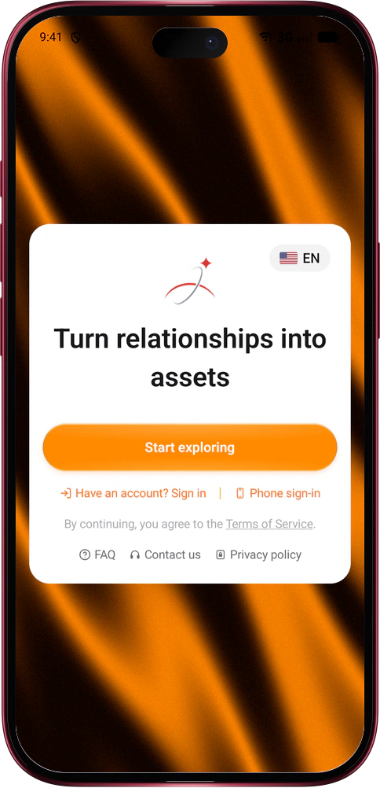

# Mars on Android, from our website

> **Preview** · 2026-11-24 · `0.1.1.14020`
> These features are available in the preview version and have not been generally released.

Your phone runs Android, and Mars lived only in a browser tab.

Open marsdata.ai/download on your phone or computer and tap Download for Android to get the MarsDataAI installer (APK, Android 13 or later). When Android asks, allow your browser to install apps, then sign in with the account you already have: your conversations, people, files and memory are the same ones you see on the web, iPhone, iPad and Mac. It is a native Android app with the same screens as the iPhone app, opened from your home screen instead of a browser tab. Found the page inside WeChat? It shows you how to open it in your browser and install from there.

Mars one tap away on your Android phone, with the same people and conversations on every device.

*Illustration using fictional demo data.*

*Illustration using fictional demo data.*

[Explore the preview](https://marsdata.ai/changelog/mars-on-android) · [All updates](../README.md)

[简体中文](./crm-2026-11-24-mars-on-android.zh-CN.md) · [繁體中文](./crm-2026-11-24-mars-on-android.zh-HK.md)
