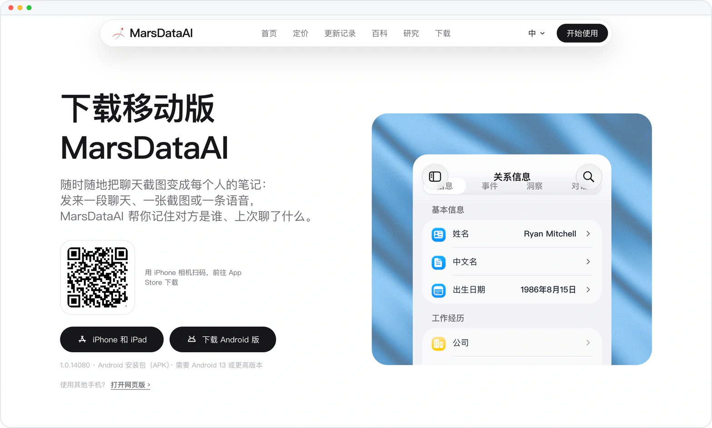
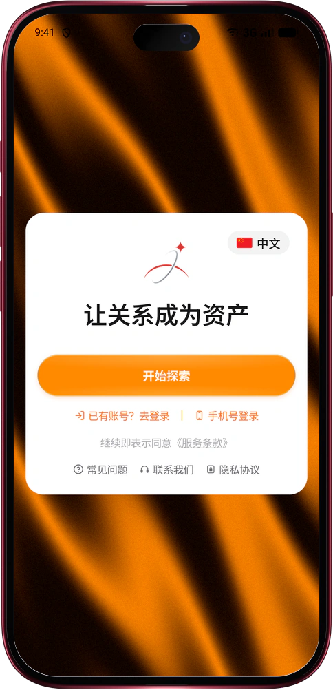

# 安卓手机也能用 Mars，官网直接下载

> **预览** · 2026-11-24 · `0.1.1.14020`
> 以下功能目前处于预览阶段，尚未正式上线。

手机是安卓，Mars 却只能在浏览器里打开？

在手机或电脑上打开 marsdata.ai/download，点「下载 Android 版」，就能拿到 MarsDataAI 安装包（APK，需要 Android 13 或更高版本）。安卓提示时允许浏览器安装应用，再用你已有的账号登录：对话、关系、文件和记忆，和网页版、iPhone、iPad、Mac 上的完全一样。这是为安卓打造的原生应用，页面与 iPhone 版一致，从桌面图标一点就开，不用再去找浏览器标签页。在微信里打开了下载页？页面会提示你换到浏览器里下载安装。

安卓手机上一点就开 Mars，换哪台设备都是同一批关系和对话。

*示意图，使用虚构演示数据。*

*示意图，使用虚构演示数据。*

[体验预览版](https://marsdata.ai/changelog/mars-on-android) · [全部更新](../README.zh-CN.md)

[English](./crm-2026-11-24-mars-on-android.md) · [繁體中文](./crm-2026-11-24-mars-on-android.zh-HK.md)
