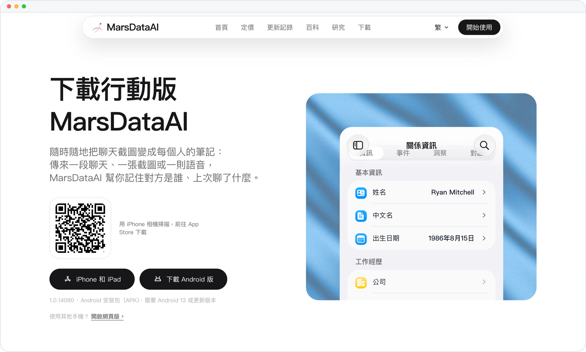
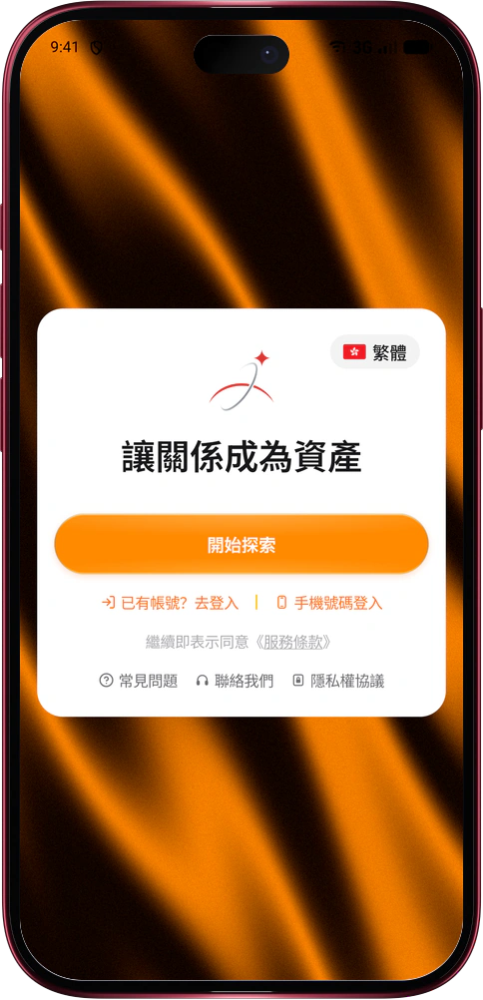

# 安卓手機也能用 Mars，官網直接下載

> **預覽** · 2026-11-24 · `0.1.1.14020`
> 以下功能目前處於預覽階段，尚未正式上線。

手機是安卓，Mars 卻只能在瀏覽器裏打開？

在手機或電腦上打開 marsdata.ai/download，點「下載 Android 版」，就能拿到 MarsDataAI 安裝包（APK，需要 Android 13 或更高版本）。安卓提示時允許瀏覽器安裝應用，再用你已有的賬號登錄：對話、關係、文件和記憶，和網頁版、iPhone、iPad、Mac 上的完全一樣。這是為安卓打造的原生應用，頁面與 iPhone 版一致，從桌面圖標一點就開，不用再去找瀏覽器標籤頁。在微信裏打開了下載頁？頁面會提示你換到瀏覽器裏下載安裝。

安卓手機上一點就開 Mars，換哪台設備都是同一批關係和對話。

*示意圖，使用虛構演示資料。*

*示意圖，使用虛構演示資料。*

[體驗預覽版](https://marsdata.ai/changelog/mars-on-android) · [全部更新](../README.zh-HK.md)

[English](./crm-2026-11-24-mars-on-android.md) · [简体中文](./crm-2026-11-24-mars-on-android.zh-CN.md)
