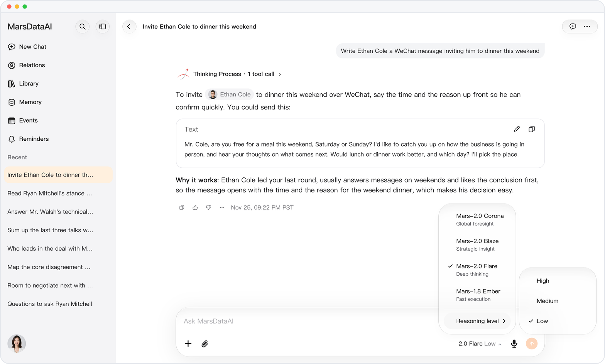
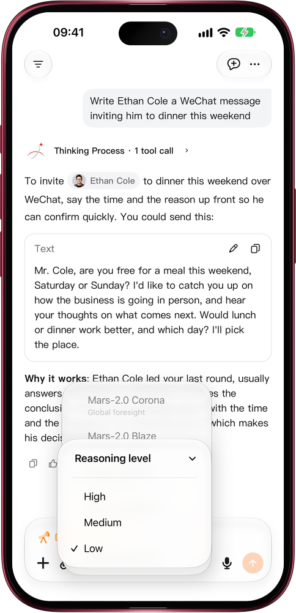

# Pick your model once, use it anywhere

> **Preview** · 2026-11-27 · `0.1.1.14538`
> These features are available in the preview version and have not been generally released.

You moved to Blaze at High on your phone, then opened your laptop and had to pick the model and the level all over again.

Pick a model and a reasoning level in the composer, and MarsDataAI saves that choice to your account. The web app and the apps on iPhone, iPad, Mac and Android start from your latest pick at their next launch or sign-in, and your first message goes out on it. A new device does the same on its very first sign-in, so there is no menu to hunt through again. Switching devices never drops you quietly back to another level. An account that has never picked still starts on Flare at Low, and Corona stays with the paid plans.

Choose once, and every device answers at the level you want from the very first message.

*Illustration using fictional demo data.*

*Illustration using fictional demo data.*

[Explore the preview](https://marsdata.ai/changelog/model-choice-follows-you) · [All updates](../README.md)

[简体中文](./crm-2026-11-27-model-choice-follows-you.zh-CN.md) · [繁體中文](./crm-2026-11-27-model-choice-follows-you.zh-HK.md)
