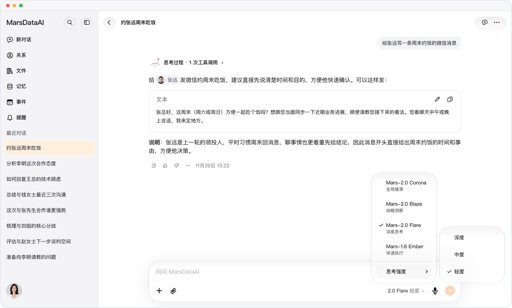
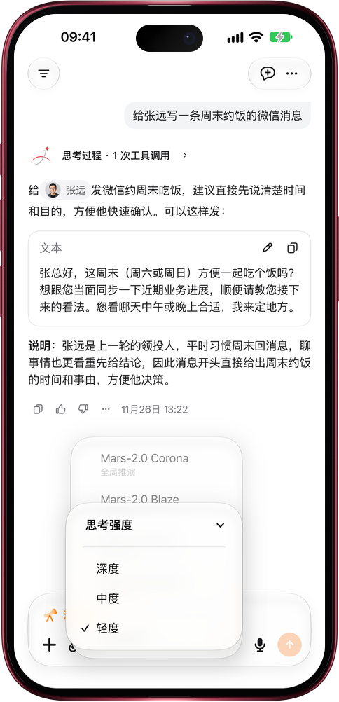

# 换台设备，还是你选的那档模型

> **预览** · 2026-11-27 · `0.1.1.14538`
> 以下功能目前处于预览阶段，尚未正式上线。

手机上刚换成 Blaze 深度，回到电脑上又得重选一遍？

在对话输入框选好模型和思考强度，MarsDataAI 就把这次选择存进你的账号。网页版和 iPhone、iPad、Mac、安卓上的应用，下次打开或登录时都从你最近选的那一档开始，第一条消息就用它发出。新设备第一次登录也一样，不用再翻一遍菜单。换了设备，也不会在不知不觉中用回别的档位回答。从没选过的账号仍从 Flare 轻度开始，Corona 依旧只对付费方案开放。

选一次，处处生效：哪台设备一开口，都是你要的那档回答。

*示意图，使用虚构演示数据。*

*示意图，使用虚构演示数据。*

[体验预览版](https://marsdata.ai/changelog/model-choice-follows-you) · [全部更新](../README.zh-CN.md)

[English](./crm-2026-11-27-model-choice-follows-you.md) · [繁體中文](./crm-2026-11-27-model-choice-follows-you.zh-HK.md)
