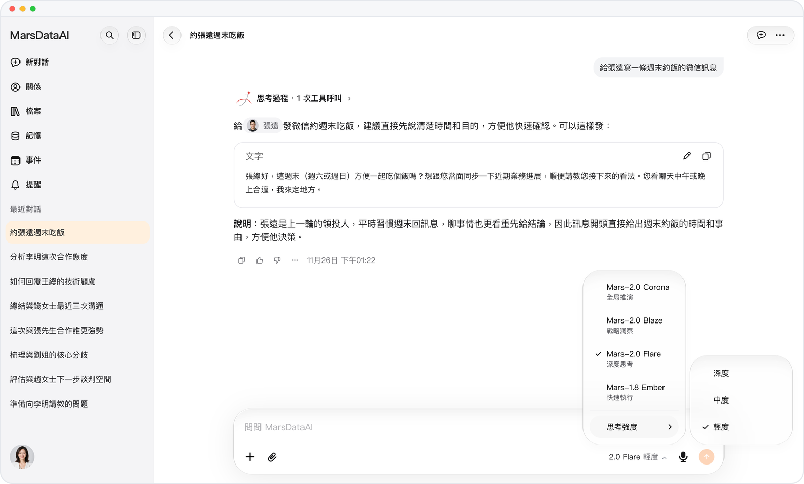
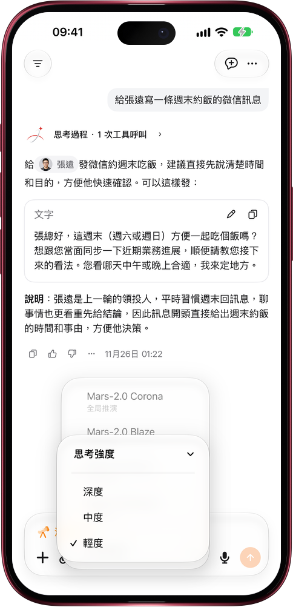

# 換台設備，還是你選的那檔模型

> **預覽** · 2026-11-27 · `0.1.1.14538`
> 以下功能目前處於預覽階段，尚未正式上線。

手機上剛換成 Blaze 深度，回到電腦上又得重選一遍？

在對話輸入框選好模型和思考強度，MarsDataAI 就把這次選擇存進你的賬號。網頁版和 iPhone、iPad、Mac、安卓上的應用，下次打開或登錄時都從你最近選的那一檔開始，第一條消息就用它發出。新設備第一次登錄也一樣，不用再翻一遍菜單。換了設備，也不會在不知不覺中用回別的檔位回答。從沒選過的賬號仍從 Flare 輕度開始，Corona 依舊只對付費方案開放。

選一次，處處生效：哪台設備一開口，都是你要的那檔回答。

*示意圖，使用虛構演示資料。*

*示意圖，使用虛構演示資料。*

[體驗預覽版](https://marsdata.ai/changelog/model-choice-follows-you) · [全部更新](../README.zh-HK.md)

[English](./crm-2026-11-27-model-choice-follows-you.md) · [简体中文](./crm-2026-11-27-model-choice-follows-you.zh-CN.md)
